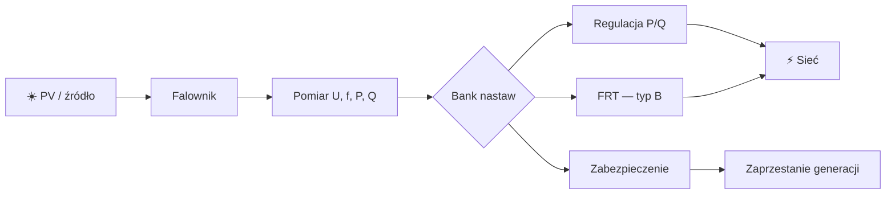
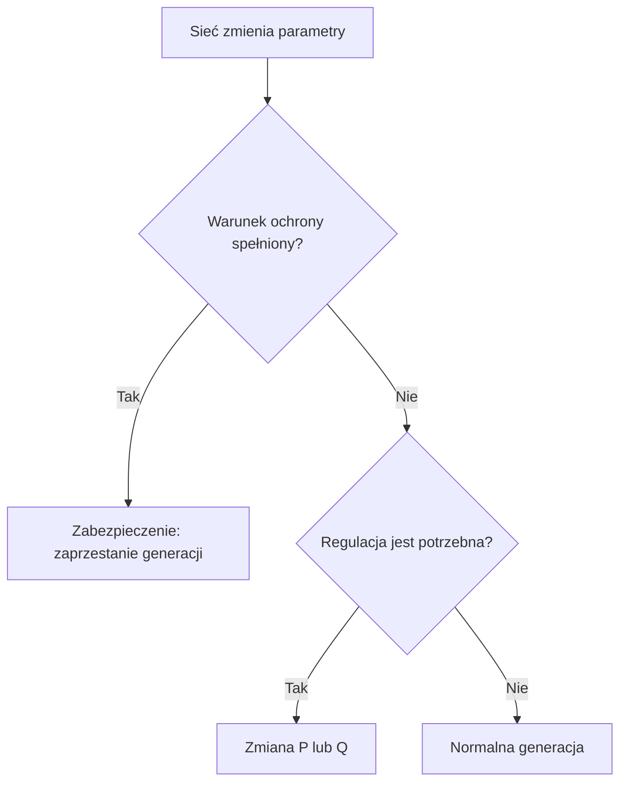

## Co reguluje falownik i jak się uczyć

> [!abstract] Co zrozumiesz?
> Po przeczytaniu powinieneś umieć wyjaśnić temat własnymi słowami i powiązać go z pomiarami oraz realnym zachowaniem falownika. To **materiał dydaktyczny**, nie zatwierdzona konfiguracja urządzenia.

### Schemat: jak elementy są połączone

**Uwaga do grafiki:** schemat jest uproszczony. Nie pokazuje odległości w skali ani wszystkich warunków pomiarowych. Diagramy Mermaid są rysowane bezpośrednio przez Obsidiana, bez zewnętrznych plików graficznych.

## 1. Instalacja PV

### Co to znaczy po ludzku?
Falownik zamienia energię DC na AC i synchronizuje pracę z siecią. Panele mogą dostarczać energię tylko w określonych warunkach nasłonecznienia. Reakcja układu zależy więc zarówno od dostępnej mocy źródła, jak i od stanu sieci.

### Przykład do prześledzenia
Wyobraź sobie 10 kW PV i pobór domu 2 kW. Około 8 kW może przepływać do sieci, jeśli nie ma innych ograniczeń.

### Jak to rozpoznać w instalacji?
Wyobraź sobie, że stoisz przy rozdzielnicy i widzisz tylko wykres z analizatora oraz historię zdarzeń falownika. Zacznij od odczytu **jednostki i punktu pomiarowego**. Czy jest to napięcie fazowe, międzyfazowe, moc kW, moc kvar, czy częstotliwość Hz? Jeżeli widzisz wartość względną, zanotuj bazę. Potem porównaj sygnał **przed zdarzeniem**, **w trakcie** i **po zdarzeniu**. Przy parametrach typu »Instalacja PV« nie zaczynaj od szukania winnego elementu: najpierw ustal, czy jest to wymaganie regulatora, czy zabezpieczenia, i czy w ogóle warunek wystąpił.

Praktyczna sekwencja diagnostyczna dla automatyka: **pomiary → aktywna funkcja → próg i metoda obliczeń → oczekiwane działanie → faktyczny stan → wniosek**. Jeśli brakuje jednego ogniwa, wynik powinien brzmieć »nie potwierdzono«, a nie »falownik działa źle«. To szczególnie ważne przy krótkotrwałych zdarzeniach, bo SCADA aktualizowana co sekundę może ich nie zapisać.

### Ćwiczenie bez ryzyka
1. Zapisz własnymi słowami, dlaczego termin **Instalacja PV** jest istotny dla sieci. Nie przepisuj tabeli; opowiedz o fizycznym zjawisku.
2. Wypisz, które wielkości trzeba zmierzyć, aby stwierdzić, że zaszła opisana sytuacja.
3. Podaj, czego **nie da się** rozstrzygnąć z jednego odczytu lub zdjęcia ekranu.
4. Odpowiedz: jak odróżnisz zachowanie poprawne od awarii bez zmieniania żadnych nastaw?

> [!tip] Jedna rzecz do zapamiętania
> **Instalacja PV**: Wyobraź sobie 10 kW PV i pobór domu 2 kW. Około 8 kW może przepływać do sieci, jeśli nie ma innych ograniczeń.

## 2. Eksport mocy

### Co to znaczy po ludzku?
Kiedy nadwyżka energii płynie z posesji do sieci, w impedancji przewodu powstaje różnica napięć. Dlatego wysokie napięcie na końcu długiej linii nie jest zaskoczeniem i może prowadzić do ograniczenia produkcji.

### Przykład do prześledzenia
Falownik na końcu obwodu rejestruje 249 V, a na transformatorze napięcie jest niższe.

### Jak to rozpoznać w instalacji?
Wyobraź sobie, że stoisz przy rozdzielnicy i widzisz tylko wykres z analizatora oraz historię zdarzeń falownika. Zacznij od odczytu **jednostki i punktu pomiarowego**. Czy jest to napięcie fazowe, międzyfazowe, moc kW, moc kvar, czy częstotliwość Hz? Jeżeli widzisz wartość względną, zanotuj bazę. Potem porównaj sygnał **przed zdarzeniem**, **w trakcie** i **po zdarzeniu**. Przy parametrach typu »Eksport mocy« nie zaczynaj od szukania winnego elementu: najpierw ustal, czy jest to wymaganie regulatora, czy zabezpieczenia, i czy w ogóle warunek wystąpił.

Praktyczna sekwencja diagnostyczna dla automatyka: **pomiary → aktywna funkcja → próg i metoda obliczeń → oczekiwane działanie → faktyczny stan → wniosek**. Jeśli brakuje jednego ogniwa, wynik powinien brzmieć »nie potwierdzono«, a nie »falownik działa źle«. To szczególnie ważne przy krótkotrwałych zdarzeniach, bo SCADA aktualizowana co sekundę może ich nie zapisać.

### Ćwiczenie bez ryzyka
1. Zapisz własnymi słowami, dlaczego termin **Eksport mocy** jest istotny dla sieci. Nie przepisuj tabeli; opowiedz o fizycznym zjawisku.
2. Wypisz, które wielkości trzeba zmierzyć, aby stwierdzić, że zaszła opisana sytuacja.
3. Podaj, czego **nie da się** rozstrzygnąć z jednego odczytu lub zdjęcia ekranu.
4. Odpowiedz: jak odróżnisz zachowanie poprawne od awarii bez zmieniania żadnych nastaw?

> [!tip] Jedna rzecz do zapamiętania
> **Eksport mocy**: Falownik na końcu obwodu rejestruje 249 V, a na transformatorze napięcie jest niższe.

## 3. Regulacja

### Co to znaczy po ludzku?
Regulator nie musi odłączać urządzenia. Może stopniowo zmieniać P lub Q, aby ograniczyć wpływ na napięcie albo częstotliwość. Zdolności urządzenia i algorytm są ograniczone.

### Przykład do prześledzenia
P(U) typu A zaczyna redukować P przy 1,08 p.u. dla odpowiedniego profilu.

### Jak to rozpoznać w instalacji?
Wyobraź sobie, że stoisz przy rozdzielnicy i widzisz tylko wykres z analizatora oraz historię zdarzeń falownika. Zacznij od odczytu **jednostki i punktu pomiarowego**. Czy jest to napięcie fazowe, międzyfazowe, moc kW, moc kvar, czy częstotliwość Hz? Jeżeli widzisz wartość względną, zanotuj bazę. Potem porównaj sygnał **przed zdarzeniem**, **w trakcie** i **po zdarzeniu**. Przy parametrach typu »Regulacja« nie zaczynaj od szukania winnego elementu: najpierw ustal, czy jest to wymaganie regulatora, czy zabezpieczenia, i czy w ogóle warunek wystąpił.

Praktyczna sekwencja diagnostyczna dla automatyka: **pomiary → aktywna funkcja → próg i metoda obliczeń → oczekiwane działanie → faktyczny stan → wniosek**. Jeśli brakuje jednego ogniwa, wynik powinien brzmieć »nie potwierdzono«, a nie »falownik działa źle«. To szczególnie ważne przy krótkotrwałych zdarzeniach, bo SCADA aktualizowana co sekundę może ich nie zapisać.

### Ćwiczenie bez ryzyka
1. Zapisz własnymi słowami, dlaczego termin **Regulacja** jest istotny dla sieci. Nie przepisuj tabeli; opowiedz o fizycznym zjawisku.
2. Wypisz, które wielkości trzeba zmierzyć, aby stwierdzić, że zaszła opisana sytuacja.
3. Podaj, czego **nie da się** rozstrzygnąć z jednego odczytu lub zdjęcia ekranu.
4. Odpowiedz: jak odróżnisz zachowanie poprawne od awarii bez zmieniania żadnych nastaw?

> [!tip] Jedna rzecz do zapamiętania
> **Regulacja**: P(U) typu A zaczyna redukować P przy 1,08 p.u. dla odpowiedniego profilu.

## 4. Zabezpieczenie

### Co to znaczy po ludzku?
Zabezpieczenie reaguje po spełnieniu zdefiniowanego kryterium. Nastawa to próg, metoda pomiaru i czas reakcji. To nie jest zwyczajny regulator.

### Przykład do prześledzenia
U>> ma wyższy próg i krótszą zwłokę niż U>.

### Jak to rozpoznać w instalacji?
Wyobraź sobie, że stoisz przy rozdzielnicy i widzisz tylko wykres z analizatora oraz historię zdarzeń falownika. Zacznij od odczytu **jednostki i punktu pomiarowego**. Czy jest to napięcie fazowe, międzyfazowe, moc kW, moc kvar, czy częstotliwość Hz? Jeżeli widzisz wartość względną, zanotuj bazę. Potem porównaj sygnał **przed zdarzeniem**, **w trakcie** i **po zdarzeniu**. Przy parametrach typu »Zabezpieczenie« nie zaczynaj od szukania winnego elementu: najpierw ustal, czy jest to wymaganie regulatora, czy zabezpieczenia, i czy w ogóle warunek wystąpił.

Praktyczna sekwencja diagnostyczna dla automatyka: **pomiary → aktywna funkcja → próg i metoda obliczeń → oczekiwane działanie → faktyczny stan → wniosek**. Jeśli brakuje jednego ogniwa, wynik powinien brzmieć »nie potwierdzono«, a nie »falownik działa źle«. To szczególnie ważne przy krótkotrwałych zdarzeniach, bo SCADA aktualizowana co sekundę może ich nie zapisać.

### Ćwiczenie bez ryzyka
1. Zapisz własnymi słowami, dlaczego termin **Zabezpieczenie** jest istotny dla sieci. Nie przepisuj tabeli; opowiedz o fizycznym zjawisku.
2. Wypisz, które wielkości trzeba zmierzyć, aby stwierdzić, że zaszła opisana sytuacja.
3. Podaj, czego **nie da się** rozstrzygnąć z jednego odczytu lub zdjęcia ekranu.
4. Odpowiedz: jak odróżnisz zachowanie poprawne od awarii bez zmieniania żadnych nastaw?

> [!tip] Jedna rzecz do zapamiętania
> **Zabezpieczenie**: U>> ma wyższy próg i krótszą zwłokę niż U>.

## 5. Wartość bazowa

### Co to znaczy po ludzku?
p.u. oznacza stosunek wielkości do bazy. Zawsze ustal bazę, zanim przeliczysz procenty na wolty.

### Przykład do prześledzenia
1,08 p.u. przy bazie 230 V oznacza 248,4 V.

### Jak to rozpoznać w instalacji?
Wyobraź sobie, że stoisz przy rozdzielnicy i widzisz tylko wykres z analizatora oraz historię zdarzeń falownika. Zacznij od odczytu **jednostki i punktu pomiarowego**. Czy jest to napięcie fazowe, międzyfazowe, moc kW, moc kvar, czy częstotliwość Hz? Jeżeli widzisz wartość względną, zanotuj bazę. Potem porównaj sygnał **przed zdarzeniem**, **w trakcie** i **po zdarzeniu**. Przy parametrach typu »Wartość bazowa« nie zaczynaj od szukania winnego elementu: najpierw ustal, czy jest to wymaganie regulatora, czy zabezpieczenia, i czy w ogóle warunek wystąpił.

Praktyczna sekwencja diagnostyczna dla automatyka: **pomiary → aktywna funkcja → próg i metoda obliczeń → oczekiwane działanie → faktyczny stan → wniosek**. Jeśli brakuje jednego ogniwa, wynik powinien brzmieć »nie potwierdzono«, a nie »falownik działa źle«. To szczególnie ważne przy krótkotrwałych zdarzeniach, bo SCADA aktualizowana co sekundę może ich nie zapisać.

### Ćwiczenie bez ryzyka
1. Zapisz własnymi słowami, dlaczego termin **Wartość bazowa** jest istotny dla sieci. Nie przepisuj tabeli; opowiedz o fizycznym zjawisku.
2. Wypisz, które wielkości trzeba zmierzyć, aby stwierdzić, że zaszła opisana sytuacja.
3. Podaj, czego **nie da się** rozstrzygnąć z jednego odczytu lub zdjęcia ekranu.
4. Odpowiedz: jak odróżnisz zachowanie poprawne od awarii bez zmieniania żadnych nastaw?

> [!tip] Jedna rzecz do zapamiętania
> **Wartość bazowa**: 1,08 p.u. przy bazie 230 V oznacza 248,4 V.

## 6. Typ A

### Co to znaczy po ludzku?
Moduły typu A w dokumencie mają bank progów napięciowych, częstotliwościowych, RoCoF oraz charakterystyki LFSM-O, Q(U) i P(U).

### Przykład do prześledzenia
Nie wolno automatycznie zakładać, że każdy falownik podłączony do nn jest typu A.

### Jak to rozpoznać w instalacji?
Wyobraź sobie, że stoisz przy rozdzielnicy i widzisz tylko wykres z analizatora oraz historię zdarzeń falownika. Zacznij od odczytu **jednostki i punktu pomiarowego**. Czy jest to napięcie fazowe, międzyfazowe, moc kW, moc kvar, czy częstotliwość Hz? Jeżeli widzisz wartość względną, zanotuj bazę. Potem porównaj sygnał **przed zdarzeniem**, **w trakcie** i **po zdarzeniu**. Przy parametrach typu »Typ A« nie zaczynaj od szukania winnego elementu: najpierw ustal, czy jest to wymaganie regulatora, czy zabezpieczenia, i czy w ogóle warunek wystąpił.

Praktyczna sekwencja diagnostyczna dla automatyka: **pomiary → aktywna funkcja → próg i metoda obliczeń → oczekiwane działanie → faktyczny stan → wniosek**. Jeśli brakuje jednego ogniwa, wynik powinien brzmieć »nie potwierdzono«, a nie »falownik działa źle«. To szczególnie ważne przy krótkotrwałych zdarzeniach, bo SCADA aktualizowana co sekundę może ich nie zapisać.

### Ćwiczenie bez ryzyka
1. Zapisz własnymi słowami, dlaczego termin **Typ A** jest istotny dla sieci. Nie przepisuj tabeli; opowiedz o fizycznym zjawisku.
2. Wypisz, które wielkości trzeba zmierzyć, aby stwierdzić, że zaszła opisana sytuacja.
3. Podaj, czego **nie da się** rozstrzygnąć z jednego odczytu lub zdjęcia ekranu.
4. Odpowiedz: jak odróżnisz zachowanie poprawne od awarii bez zmieniania żadnych nastaw?

> [!tip] Jedna rzecz do zapamiętania
> **Typ A**: Nie wolno automatycznie zakładać, że każdy falownik podłączony do nn jest typu A.

## 7. Typ B

### Co to znaczy po ludzku?
Typ B ma dodatkowo szczegółowe wymagania FRT, wsparcia sieci podczas zwarcia oraz odbudowy P. Dokument opisuje B zarówno przy nn, jak i SN.

### Przykład do prześledzenia
Zwarcie nie zawsze oznacza obowiązek natychmiastowego odłączenia B.

### Jak to rozpoznać w instalacji?
Wyobraź sobie, że stoisz przy rozdzielnicy i widzisz tylko wykres z analizatora oraz historię zdarzeń falownika. Zacznij od odczytu **jednostki i punktu pomiarowego**. Czy jest to napięcie fazowe, międzyfazowe, moc kW, moc kvar, czy częstotliwość Hz? Jeżeli widzisz wartość względną, zanotuj bazę. Potem porównaj sygnał **przed zdarzeniem**, **w trakcie** i **po zdarzeniu**. Przy parametrach typu »Typ B« nie zaczynaj od szukania winnego elementu: najpierw ustal, czy jest to wymaganie regulatora, czy zabezpieczenia, i czy w ogóle warunek wystąpił.

Praktyczna sekwencja diagnostyczna dla automatyka: **pomiary → aktywna funkcja → próg i metoda obliczeń → oczekiwane działanie → faktyczny stan → wniosek**. Jeśli brakuje jednego ogniwa, wynik powinien brzmieć »nie potwierdzono«, a nie »falownik działa źle«. To szczególnie ważne przy krótkotrwałych zdarzeniach, bo SCADA aktualizowana co sekundę może ich nie zapisać.

### Ćwiczenie bez ryzyka
1. Zapisz własnymi słowami, dlaczego termin **Typ B** jest istotny dla sieci. Nie przepisuj tabeli; opowiedz o fizycznym zjawisku.
2. Wypisz, które wielkości trzeba zmierzyć, aby stwierdzić, że zaszła opisana sytuacja.
3. Podaj, czego **nie da się** rozstrzygnąć z jednego odczytu lub zdjęcia ekranu.
4. Odpowiedz: jak odróżnisz zachowanie poprawne od awarii bez zmieniania żadnych nastaw?

> [!tip] Jedna rzecz do zapamiętania
> **Typ B**: Zwarcie nie zawsze oznacza obowiązek natychmiastowego odłączenia B.

## 8. FRT

### Co to znaczy po ludzku?
Fault Ride Through to obowiązek zachowania pracy w odpowiednim obszarze napięciowo-czasowym w czasie zakłócenia. Obszar jest rysowany na wykresie U(t).

### Przykład do prześledzenia
Napięcie może spaść bardzo nisko na ułamki sekundy, a urządzenie nadal ma wymagany obszar pozostania w pracy.

### Jak to rozpoznać w instalacji?
Wyobraź sobie, że stoisz przy rozdzielnicy i widzisz tylko wykres z analizatora oraz historię zdarzeń falownika. Zacznij od odczytu **jednostki i punktu pomiarowego**. Czy jest to napięcie fazowe, międzyfazowe, moc kW, moc kvar, czy częstotliwość Hz? Jeżeli widzisz wartość względną, zanotuj bazę. Potem porównaj sygnał **przed zdarzeniem**, **w trakcie** i **po zdarzeniu**. Przy parametrach typu »FRT« nie zaczynaj od szukania winnego elementu: najpierw ustal, czy jest to wymaganie regulatora, czy zabezpieczenia, i czy w ogóle warunek wystąpił.

Praktyczna sekwencja diagnostyczna dla automatyka: **pomiary → aktywna funkcja → próg i metoda obliczeń → oczekiwane działanie → faktyczny stan → wniosek**. Jeśli brakuje jednego ogniwa, wynik powinien brzmieć »nie potwierdzono«, a nie »falownik działa źle«. To szczególnie ważne przy krótkotrwałych zdarzeniach, bo SCADA aktualizowana co sekundę może ich nie zapisać.

### Ćwiczenie bez ryzyka
1. Zapisz własnymi słowami, dlaczego termin **FRT** jest istotny dla sieci. Nie przepisuj tabeli; opowiedz o fizycznym zjawisku.
2. Wypisz, które wielkości trzeba zmierzyć, aby stwierdzić, że zaszła opisana sytuacja.
3. Podaj, czego **nie da się** rozstrzygnąć z jednego odczytu lub zdjęcia ekranu.
4. Odpowiedz: jak odróżnisz zachowanie poprawne od awarii bez zmieniania żadnych nastaw?

> [!tip] Jedna rzecz do zapamiętania
> **FRT**: Napięcie może spaść bardzo nisko na ułamki sekundy, a urządzenie nadal ma wymagany obszar pozostania w pracy.

## 9. PCC

### Co to znaczy po ludzku?
Punkt wspólnego przyłączenia jest miejscem odniesienia wymagań sieciowych. Napięcie i Q na zaciskach falownika mogą się różnić od wartości w PCC.

### Przykład do prześledzenia
Transformator i przewody mogą pochłaniać lub generować Q między falownikiem a siecią.

### Jak to rozpoznać w instalacji?
Wyobraź sobie, że stoisz przy rozdzielnicy i widzisz tylko wykres z analizatora oraz historię zdarzeń falownika. Zacznij od odczytu **jednostki i punktu pomiarowego**. Czy jest to napięcie fazowe, międzyfazowe, moc kW, moc kvar, czy częstotliwość Hz? Jeżeli widzisz wartość względną, zanotuj bazę. Potem porównaj sygnał **przed zdarzeniem**, **w trakcie** i **po zdarzeniu**. Przy parametrach typu »PCC« nie zaczynaj od szukania winnego elementu: najpierw ustal, czy jest to wymaganie regulatora, czy zabezpieczenia, i czy w ogóle warunek wystąpił.

Praktyczna sekwencja diagnostyczna dla automatyka: **pomiary → aktywna funkcja → próg i metoda obliczeń → oczekiwane działanie → faktyczny stan → wniosek**. Jeśli brakuje jednego ogniwa, wynik powinien brzmieć »nie potwierdzono«, a nie »falownik działa źle«. To szczególnie ważne przy krótkotrwałych zdarzeniach, bo SCADA aktualizowana co sekundę może ich nie zapisać.

### Ćwiczenie bez ryzyka
1. Zapisz własnymi słowami, dlaczego termin **PCC** jest istotny dla sieci. Nie przepisuj tabeli; opowiedz o fizycznym zjawisku.
2. Wypisz, które wielkości trzeba zmierzyć, aby stwierdzić, że zaszła opisana sytuacja.
3. Podaj, czego **nie da się** rozstrzygnąć z jednego odczytu lub zdjęcia ekranu.
4. Odpowiedz: jak odróżnisz zachowanie poprawne od awarii bez zmieniania żadnych nastaw?

> [!tip] Jedna rzecz do zapamiętania
> **PCC**: Transformator i przewody mogą pochłaniać lub generować Q między falownikiem a siecią.

## 10. Diagnostyka

### Co to znaczy po ludzku?
W analizie zdarzenia zawsze ustal: czas, wartość U/f, punkt pomiarowy, stan regulatora, stan zabezpieczenia i przyczynę w rejestrze falownika.

### Przykład do prześledzenia
Sam komunikat »grid fault« nie wyjaśnia, czy zadziałało U>, RoCoF czy błąd pomiarowy.

### Jak to rozpoznać w instalacji?
Wyobraź sobie, że stoisz przy rozdzielnicy i widzisz tylko wykres z analizatora oraz historię zdarzeń falownika. Zacznij od odczytu **jednostki i punktu pomiarowego**. Czy jest to napięcie fazowe, międzyfazowe, moc kW, moc kvar, czy częstotliwość Hz? Jeżeli widzisz wartość względną, zanotuj bazę. Potem porównaj sygnał **przed zdarzeniem**, **w trakcie** i **po zdarzeniu**. Przy parametrach typu »Diagnostyka« nie zaczynaj od szukania winnego elementu: najpierw ustal, czy jest to wymaganie regulatora, czy zabezpieczenia, i czy w ogóle warunek wystąpił.

Praktyczna sekwencja diagnostyczna dla automatyka: **pomiary → aktywna funkcja → próg i metoda obliczeń → oczekiwane działanie → faktyczny stan → wniosek**. Jeśli brakuje jednego ogniwa, wynik powinien brzmieć »nie potwierdzono«, a nie »falownik działa źle«. To szczególnie ważne przy krótkotrwałych zdarzeniach, bo SCADA aktualizowana co sekundę może ich nie zapisać.

### Ćwiczenie bez ryzyka
1. Zapisz własnymi słowami, dlaczego termin **Diagnostyka** jest istotny dla sieci. Nie przepisuj tabeli; opowiedz o fizycznym zjawisku.
2. Wypisz, które wielkości trzeba zmierzyć, aby stwierdzić, że zaszła opisana sytuacja.
3. Podaj, czego **nie da się** rozstrzygnąć z jednego odczytu lub zdjęcia ekranu.
4. Odpowiedz: jak odróżnisz zachowanie poprawne od awarii bez zmieniania żadnych nastaw?

> [!tip] Jedna rzecz do zapamiętania
> **Diagnostyka**: Sam komunikat »grid fault« nie wyjaśnia, czy zadziałało U>, RoCoF czy błąd pomiarowy.

## Studium przypadków: od schematu do wniosku

### Scenariusz 1: Instalacja PV
Masz zadanie sprawdzić instalację, w której operator zgłosił nietypowe zachowanie związane z obszarem **Instalacja PV**. W pierwszym kroku nie zmieniasz konfiguracji. Przygotowujesz zestaw danych: topologię przyłączenia, wartości znamionowe i bazy, historię U/f/P/Q, znaczniki czasu, stany sterowania nadrzędnego i kody zdarzeń. **Hipoteza robocza:** Falownik zamienia energię DC na AC i synchronizuje pracę z siecią. Panele mogą dostarczać energię tylko w określonych warunkach nasłonecznienia. Reakcja układu zależy więc zarówno od dostępnej mocy źródła, jak i od stanu sieci. Zestaw tę hipotezę z obserwacją: Wyobraź sobie 10 kW PV i pobór domu 2 kW. Około 8 kW może przepływać do sieci, jeśli nie ma innych ograniczeń. Następnie odpowiedz, co potwierdza wymaganie dokumentu, a co jest tylko możliwym zachowaniem konkretnego urządzenia. Gdy pojawia się sprzeczność, sprawdź najpierw jednostki i kierunki przepływu, dopiero potem oceniaj oprogramowanie. Zakończ tabelą: obserwacja, oczekiwane zachowanie, źródło wymagania, dane brakujące, werdykt. Nie wykonuj prób zwarciowych ani zmiany zabezpieczeń w czynnej instalacji.

### Scenariusz 2: Eksport mocy
Masz zadanie sprawdzić instalację, w której operator zgłosił nietypowe zachowanie związane z obszarem **Eksport mocy**. W pierwszym kroku nie zmieniasz konfiguracji. Przygotowujesz zestaw danych: topologię przyłączenia, wartości znamionowe i bazy, historię U/f/P/Q, znaczniki czasu, stany sterowania nadrzędnego i kody zdarzeń. **Hipoteza robocza:** Kiedy nadwyżka energii płynie z posesji do sieci, w impedancji przewodu powstaje różnica napięć. Dlatego wysokie napięcie na końcu długiej linii nie jest zaskoczeniem i może prowadzić do ograniczenia produkcji. Zestaw tę hipotezę z obserwacją: Falownik na końcu obwodu rejestruje 249 V, a na transformatorze napięcie jest niższe. Następnie odpowiedz, co potwierdza wymaganie dokumentu, a co jest tylko możliwym zachowaniem konkretnego urządzenia. Gdy pojawia się sprzeczność, sprawdź najpierw jednostki i kierunki przepływu, dopiero potem oceniaj oprogramowanie. Zakończ tabelą: obserwacja, oczekiwane zachowanie, źródło wymagania, dane brakujące, werdykt. Nie wykonuj prób zwarciowych ani zmiany zabezpieczeń w czynnej instalacji.

### Scenariusz 3: Regulacja
Masz zadanie sprawdzić instalację, w której operator zgłosił nietypowe zachowanie związane z obszarem **Regulacja**. W pierwszym kroku nie zmieniasz konfiguracji. Przygotowujesz zestaw danych: topologię przyłączenia, wartości znamionowe i bazy, historię U/f/P/Q, znaczniki czasu, stany sterowania nadrzędnego i kody zdarzeń. **Hipoteza robocza:** Regulator nie musi odłączać urządzenia. Może stopniowo zmieniać P lub Q, aby ograniczyć wpływ na napięcie albo częstotliwość. Zdolności urządzenia i algorytm są ograniczone. Zestaw tę hipotezę z obserwacją: P(U) typu A zaczyna redukować P przy 1,08 p.u. dla odpowiedniego profilu. Następnie odpowiedz, co potwierdza wymaganie dokumentu, a co jest tylko możliwym zachowaniem konkretnego urządzenia. Gdy pojawia się sprzeczność, sprawdź najpierw jednostki i kierunki przepływu, dopiero potem oceniaj oprogramowanie. Zakończ tabelą: obserwacja, oczekiwane zachowanie, źródło wymagania, dane brakujące, werdykt. Nie wykonuj prób zwarciowych ani zmiany zabezpieczeń w czynnej instalacji.

### Scenariusz 4: Zabezpieczenie
Masz zadanie sprawdzić instalację, w której operator zgłosił nietypowe zachowanie związane z obszarem **Zabezpieczenie**. W pierwszym kroku nie zmieniasz konfiguracji. Przygotowujesz zestaw danych: topologię przyłączenia, wartości znamionowe i bazy, historię U/f/P/Q, znaczniki czasu, stany sterowania nadrzędnego i kody zdarzeń. **Hipoteza robocza:** Zabezpieczenie reaguje po spełnieniu zdefiniowanego kryterium. Nastawa to próg, metoda pomiaru i czas reakcji. To nie jest zwyczajny regulator. Zestaw tę hipotezę z obserwacją: U>> ma wyższy próg i krótszą zwłokę niż U>. Następnie odpowiedz, co potwierdza wymaganie dokumentu, a co jest tylko możliwym zachowaniem konkretnego urządzenia. Gdy pojawia się sprzeczność, sprawdź najpierw jednostki i kierunki przepływu, dopiero potem oceniaj oprogramowanie. Zakończ tabelą: obserwacja, oczekiwane zachowanie, źródło wymagania, dane brakujące, werdykt. Nie wykonuj prób zwarciowych ani zmiany zabezpieczeń w czynnej instalacji.

### Scenariusz 5: Wartość bazowa
Masz zadanie sprawdzić instalację, w której operator zgłosił nietypowe zachowanie związane z obszarem **Wartość bazowa**. W pierwszym kroku nie zmieniasz konfiguracji. Przygotowujesz zestaw danych: topologię przyłączenia, wartości znamionowe i bazy, historię U/f/P/Q, znaczniki czasu, stany sterowania nadrzędnego i kody zdarzeń. **Hipoteza robocza:** p.u. oznacza stosunek wielkości do bazy. Zawsze ustal bazę, zanim przeliczysz procenty na wolty. Zestaw tę hipotezę z obserwacją: 1,08 p.u. przy bazie 230 V oznacza 248,4 V. Następnie odpowiedz, co potwierdza wymaganie dokumentu, a co jest tylko możliwym zachowaniem konkretnego urządzenia. Gdy pojawia się sprzeczność, sprawdź najpierw jednostki i kierunki przepływu, dopiero potem oceniaj oprogramowanie. Zakończ tabelą: obserwacja, oczekiwane zachowanie, źródło wymagania, dane brakujące, werdykt. Nie wykonuj prób zwarciowych ani zmiany zabezpieczeń w czynnej instalacji.

### Scenariusz 6: Typ A
Masz zadanie sprawdzić instalację, w której operator zgłosił nietypowe zachowanie związane z obszarem **Typ A**. W pierwszym kroku nie zmieniasz konfiguracji. Przygotowujesz zestaw danych: topologię przyłączenia, wartości znamionowe i bazy, historię U/f/P/Q, znaczniki czasu, stany sterowania nadrzędnego i kody zdarzeń. **Hipoteza robocza:** Moduły typu A w dokumencie mają bank progów napięciowych, częstotliwościowych, RoCoF oraz charakterystyki LFSM-O, Q(U) i P(U). Zestaw tę hipotezę z obserwacją: Nie wolno automatycznie zakładać, że każdy falownik podłączony do nn jest typu A. Następnie odpowiedz, co potwierdza wymaganie dokumentu, a co jest tylko możliwym zachowaniem konkretnego urządzenia. Gdy pojawia się sprzeczność, sprawdź najpierw jednostki i kierunki przepływu, dopiero potem oceniaj oprogramowanie. Zakończ tabelą: obserwacja, oczekiwane zachowanie, źródło wymagania, dane brakujące, werdykt. Nie wykonuj prób zwarciowych ani zmiany zabezpieczeń w czynnej instalacji.

### Scenariusz 7: Typ B
Masz zadanie sprawdzić instalację, w której operator zgłosił nietypowe zachowanie związane z obszarem **Typ B**. W pierwszym kroku nie zmieniasz konfiguracji. Przygotowujesz zestaw danych: topologię przyłączenia, wartości znamionowe i bazy, historię U/f/P/Q, znaczniki czasu, stany sterowania nadrzędnego i kody zdarzeń. **Hipoteza robocza:** Typ B ma dodatkowo szczegółowe wymagania FRT, wsparcia sieci podczas zwarcia oraz odbudowy P. Dokument opisuje B zarówno przy nn, jak i SN. Zestaw tę hipotezę z obserwacją: Zwarcie nie zawsze oznacza obowiązek natychmiastowego odłączenia B. Następnie odpowiedz, co potwierdza wymaganie dokumentu, a co jest tylko możliwym zachowaniem konkretnego urządzenia. Gdy pojawia się sprzeczność, sprawdź najpierw jednostki i kierunki przepływu, dopiero potem oceniaj oprogramowanie. Zakończ tabelą: obserwacja, oczekiwane zachowanie, źródło wymagania, dane brakujące, werdykt. Nie wykonuj prób zwarciowych ani zmiany zabezpieczeń w czynnej instalacji.

### Scenariusz 8: FRT
Masz zadanie sprawdzić instalację, w której operator zgłosił nietypowe zachowanie związane z obszarem **FRT**. W pierwszym kroku nie zmieniasz konfiguracji. Przygotowujesz zestaw danych: topologię przyłączenia, wartości znamionowe i bazy, historię U/f/P/Q, znaczniki czasu, stany sterowania nadrzędnego i kody zdarzeń. **Hipoteza robocza:** Fault Ride Through to obowiązek zachowania pracy w odpowiednim obszarze napięciowo-czasowym w czasie zakłócenia. Obszar jest rysowany na wykresie U(t). Zestaw tę hipotezę z obserwacją: Napięcie może spaść bardzo nisko na ułamki sekundy, a urządzenie nadal ma wymagany obszar pozostania w pracy. Następnie odpowiedz, co potwierdza wymaganie dokumentu, a co jest tylko możliwym zachowaniem konkretnego urządzenia. Gdy pojawia się sprzeczność, sprawdź najpierw jednostki i kierunki przepływu, dopiero potem oceniaj oprogramowanie. Zakończ tabelą: obserwacja, oczekiwane zachowanie, źródło wymagania, dane brakujące, werdykt. Nie wykonuj prób zwarciowych ani zmiany zabezpieczeń w czynnej instalacji.

## Koniec rozdziału — pięć pytań
1. Jakie fizyczne zjawisko omawia ten rozdział?
2. Kiedy urządzenie powinno **regulować moc**, a kiedy działać ochronnie?
3. Który sygnał trzeba sprawdzić w PLC/SCADA i z jaką rozdzielczością czasową?
4. Jakie dane o urządzeniu i sieci trzeba ustalić przed oceną zdarzenia?
5. Co stanowi wymaganie literalne PTPiREE, a co jest jedynie objaśnieniem dydaktycznym?

Źródło: [PTPiREE – Bank Nastaw dla Polski, wersja 1.1, 01.10.2024](https://ptpiree.pl/wp-content/uploads/2024/12/bn_2024_10_01-1.pdf). Szczegółowe wykresy i przypisy sprawdź w źródłowym PDF.

## Drugi rysunek — decyzja falownika

