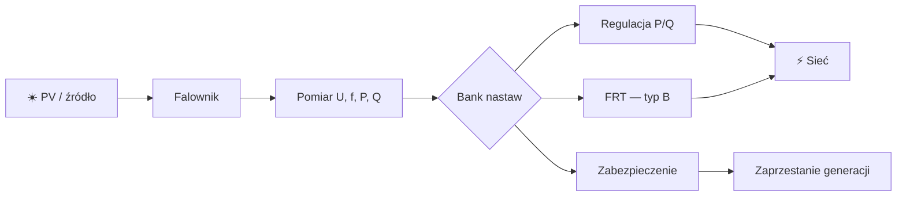

## Skąd biorą się ograniczenia falowników

> [!abstract] Co zrozumiesz?
> Po przeczytaniu powinieneś umieć wyjaśnić temat własnymi słowami i powiązać go z pomiarami oraz realnym zachowaniem falownika. To **materiał dydaktyczny**, nie zatwierdzona konfiguracja urządzenia.

### Schemat: jak elementy są połączone

**Uwaga do grafiki:** schemat jest uproszczony. Nie pokazuje odległości w skali ani wszystkich warunków pomiarowych. Diagramy Mermaid są rysowane bezpośrednio przez Obsidiana, bez zewnętrznych plików graficznych.

## 1. Generator w sieci

### Co to znaczy po ludzku?
Falownik przyłączony do sieci nie pracuje w oderwaniu od innych odbiorców. Zmiany mocy wpływają na prądy, przepływy P i Q oraz poziomy U. System wymaga skoordynowanego zachowania wielu urządzeń.

### Przykład do prześledzenia
W słoneczny dzień wiele dachowych PV zmienia kierunek przepływu energii na odcinku linii.

### Jak to rozpoznać w instalacji?
Wyobraź sobie, że stoisz przy rozdzielnicy i widzisz tylko wykres z analizatora oraz historię zdarzeń falownika. Zacznij od odczytu **jednostki i punktu pomiarowego**. Czy jest to napięcie fazowe, międzyfazowe, moc kW, moc kvar, czy częstotliwość Hz? Jeżeli widzisz wartość względną, zanotuj bazę. Potem porównaj sygnał **przed zdarzeniem**, **w trakcie** i **po zdarzeniu**. Przy parametrach typu »Generator w sieci« nie zaczynaj od szukania winnego elementu: najpierw ustal, czy jest to wymaganie regulatora, czy zabezpieczenia, i czy w ogóle warunek wystąpił.

Praktyczna sekwencja diagnostyczna dla automatyka: **pomiary → aktywna funkcja → próg i metoda obliczeń → oczekiwane działanie → faktyczny stan → wniosek**. Jeśli brakuje jednego ogniwa, wynik powinien brzmieć »nie potwierdzono«, a nie »falownik działa źle«. To szczególnie ważne przy krótkotrwałych zdarzeniach, bo SCADA aktualizowana co sekundę może ich nie zapisać.

### Ćwiczenie bez ryzyka
1. Zapisz własnymi słowami, dlaczego termin **Generator w sieci** jest istotny dla sieci. Nie przepisuj tabeli; opowiedz o fizycznym zjawisku.
2. Wypisz, które wielkości trzeba zmierzyć, aby stwierdzić, że zaszła opisana sytuacja.
3. Podaj, czego **nie da się** rozstrzygnąć z jednego odczytu lub zdjęcia ekranu.
4. Odpowiedz: jak odróżnisz zachowanie poprawne od awarii bez zmieniania żadnych nastaw?

> [!tip] Jedna rzecz do zapamiętania
> **Generator w sieci**: W słoneczny dzień wiele dachowych PV zmienia kierunek przepływu energii na odcinku linii.

## 2. Impedancja linii

### Co to znaczy po ludzku?
Przewód ma rezystancję oraz reaktancję. Eksport mocy czynnej przez rezystancję może powodować lokalny wzrost napięcia po stronie źródła, a wymiana Q również wpływa na spadki i wzrosty napięcia.

### Przykład do prześledzenia
Dwie identyczne instalacje na różnych długościach przewodu mogą widzieć inne U.

### Jak to rozpoznać w instalacji?
Wyobraź sobie, że stoisz przy rozdzielnicy i widzisz tylko wykres z analizatora oraz historię zdarzeń falownika. Zacznij od odczytu **jednostki i punktu pomiarowego**. Czy jest to napięcie fazowe, międzyfazowe, moc kW, moc kvar, czy częstotliwość Hz? Jeżeli widzisz wartość względną, zanotuj bazę. Potem porównaj sygnał **przed zdarzeniem**, **w trakcie** i **po zdarzeniu**. Przy parametrach typu »Impedancja linii« nie zaczynaj od szukania winnego elementu: najpierw ustal, czy jest to wymaganie regulatora, czy zabezpieczenia, i czy w ogóle warunek wystąpił.

Praktyczna sekwencja diagnostyczna dla automatyka: **pomiary → aktywna funkcja → próg i metoda obliczeń → oczekiwane działanie → faktyczny stan → wniosek**. Jeśli brakuje jednego ogniwa, wynik powinien brzmieć »nie potwierdzono«, a nie »falownik działa źle«. To szczególnie ważne przy krótkotrwałych zdarzeniach, bo SCADA aktualizowana co sekundę może ich nie zapisać.

### Ćwiczenie bez ryzyka
1. Zapisz własnymi słowami, dlaczego termin **Impedancja linii** jest istotny dla sieci. Nie przepisuj tabeli; opowiedz o fizycznym zjawisku.
2. Wypisz, które wielkości trzeba zmierzyć, aby stwierdzić, że zaszła opisana sytuacja.
3. Podaj, czego **nie da się** rozstrzygnąć z jednego odczytu lub zdjęcia ekranu.
4. Odpowiedz: jak odróżnisz zachowanie poprawne od awarii bez zmieniania żadnych nastaw?

> [!tip] Jedna rzecz do zapamiętania
> **Impedancja linii**: Dwie identyczne instalacje na różnych długościach przewodu mogą widzieć inne U.

## 3. Parametry jakości energii

### Co to znaczy po ludzku?
Sieć nie może mieć dowolnego napięcia i częstotliwości. Dokument opisuje funkcje, które ograniczają skutki pracy rozproszonej generacji.

### Przykład do prześledzenia
Jeżeli U rośnie, urządzenie powinno odpowiednio reagować, zanim sytuacja się pogorszy.

### Jak to rozpoznać w instalacji?
Wyobraź sobie, że stoisz przy rozdzielnicy i widzisz tylko wykres z analizatora oraz historię zdarzeń falownika. Zacznij od odczytu **jednostki i punktu pomiarowego**. Czy jest to napięcie fazowe, międzyfazowe, moc kW, moc kvar, czy częstotliwość Hz? Jeżeli widzisz wartość względną, zanotuj bazę. Potem porównaj sygnał **przed zdarzeniem**, **w trakcie** i **po zdarzeniu**. Przy parametrach typu »Parametry jakości energii« nie zaczynaj od szukania winnego elementu: najpierw ustal, czy jest to wymaganie regulatora, czy zabezpieczenia, i czy w ogóle warunek wystąpił.

Praktyczna sekwencja diagnostyczna dla automatyka: **pomiary → aktywna funkcja → próg i metoda obliczeń → oczekiwane działanie → faktyczny stan → wniosek**. Jeśli brakuje jednego ogniwa, wynik powinien brzmieć »nie potwierdzono«, a nie »falownik działa źle«. To szczególnie ważne przy krótkotrwałych zdarzeniach, bo SCADA aktualizowana co sekundę może ich nie zapisać.

### Ćwiczenie bez ryzyka
1. Zapisz własnymi słowami, dlaczego termin **Parametry jakości energii** jest istotny dla sieci. Nie przepisuj tabeli; opowiedz o fizycznym zjawisku.
2. Wypisz, które wielkości trzeba zmierzyć, aby stwierdzić, że zaszła opisana sytuacja.
3. Podaj, czego **nie da się** rozstrzygnąć z jednego odczytu lub zdjęcia ekranu.
4. Odpowiedz: jak odróżnisz zachowanie poprawne od awarii bez zmieniania żadnych nastaw?

> [!tip] Jedna rzecz do zapamiętania
> **Parametry jakości energii**: Jeżeli U rośnie, urządzenie powinno odpowiednio reagować, zanim sytuacja się pogorszy.

## 4. Tryb regulacyjny

### Co to znaczy po ludzku?
Regulacja służy dalszej pracy przy zmienionych parametrach. Ma krzywą, progi startu i ograniczenia. Nie należy utożsamiać jej z wyzwoleniem ochrony.

### Przykład do prześledzenia
P(U) zmienia moc aktywną, a U> jest zabezpieczeniem.

### Jak to rozpoznać w instalacji?
Wyobraź sobie, że stoisz przy rozdzielnicy i widzisz tylko wykres z analizatora oraz historię zdarzeń falownika. Zacznij od odczytu **jednostki i punktu pomiarowego**. Czy jest to napięcie fazowe, międzyfazowe, moc kW, moc kvar, czy częstotliwość Hz? Jeżeli widzisz wartość względną, zanotuj bazę. Potem porównaj sygnał **przed zdarzeniem**, **w trakcie** i **po zdarzeniu**. Przy parametrach typu »Tryb regulacyjny« nie zaczynaj od szukania winnego elementu: najpierw ustal, czy jest to wymaganie regulatora, czy zabezpieczenia, i czy w ogóle warunek wystąpił.

Praktyczna sekwencja diagnostyczna dla automatyka: **pomiary → aktywna funkcja → próg i metoda obliczeń → oczekiwane działanie → faktyczny stan → wniosek**. Jeśli brakuje jednego ogniwa, wynik powinien brzmieć »nie potwierdzono«, a nie »falownik działa źle«. To szczególnie ważne przy krótkotrwałych zdarzeniach, bo SCADA aktualizowana co sekundę może ich nie zapisać.

### Ćwiczenie bez ryzyka
1. Zapisz własnymi słowami, dlaczego termin **Tryb regulacyjny** jest istotny dla sieci. Nie przepisuj tabeli; opowiedz o fizycznym zjawisku.
2. Wypisz, które wielkości trzeba zmierzyć, aby stwierdzić, że zaszła opisana sytuacja.
3. Podaj, czego **nie da się** rozstrzygnąć z jednego odczytu lub zdjęcia ekranu.
4. Odpowiedz: jak odróżnisz zachowanie poprawne od awarii bez zmieniania żadnych nastaw?

> [!tip] Jedna rzecz do zapamiętania
> **Tryb regulacyjny**: P(U) zmienia moc aktywną, a U> jest zabezpieczeniem.

## 5. Próg ochronny

### Co to znaczy po ludzku?
Zabezpieczenie ma próg i zwłokę, ale liczy się też sposób pomiaru. Bardzo krótki pik i trwała zmiana średniej to różne zdarzenia.

### Przykład do prześledzenia
U> z przypisem o średniej 10-minutowej wymaga właściwego sygnału wejściowego.

### Jak to rozpoznać w instalacji?
Wyobraź sobie, że stoisz przy rozdzielnicy i widzisz tylko wykres z analizatora oraz historię zdarzeń falownika. Zacznij od odczytu **jednostki i punktu pomiarowego**. Czy jest to napięcie fazowe, międzyfazowe, moc kW, moc kvar, czy częstotliwość Hz? Jeżeli widzisz wartość względną, zanotuj bazę. Potem porównaj sygnał **przed zdarzeniem**, **w trakcie** i **po zdarzeniu**. Przy parametrach typu »Próg ochronny« nie zaczynaj od szukania winnego elementu: najpierw ustal, czy jest to wymaganie regulatora, czy zabezpieczenia, i czy w ogóle warunek wystąpił.

Praktyczna sekwencja diagnostyczna dla automatyka: **pomiary → aktywna funkcja → próg i metoda obliczeń → oczekiwane działanie → faktyczny stan → wniosek**. Jeśli brakuje jednego ogniwa, wynik powinien brzmieć »nie potwierdzono«, a nie »falownik działa źle«. To szczególnie ważne przy krótkotrwałych zdarzeniach, bo SCADA aktualizowana co sekundę może ich nie zapisać.

### Ćwiczenie bez ryzyka
1. Zapisz własnymi słowami, dlaczego termin **Próg ochronny** jest istotny dla sieci. Nie przepisuj tabeli; opowiedz o fizycznym zjawisku.
2. Wypisz, które wielkości trzeba zmierzyć, aby stwierdzić, że zaszła opisana sytuacja.
3. Podaj, czego **nie da się** rozstrzygnąć z jednego odczytu lub zdjęcia ekranu.
4. Odpowiedz: jak odróżnisz zachowanie poprawne od awarii bez zmieniania żadnych nastaw?

> [!tip] Jedna rzecz do zapamiętania
> **Próg ochronny**: U> z przypisem o średniej 10-minutowej wymaga właściwego sygnału wejściowego.

## 6. Ochrona dwustopniowa

### Co to znaczy po ludzku?
Dwa progi nadnapięciowe pozwalają reagować inaczej na umiarkowane i bardzo duże przekroczenie. Stopień wyższy jest szybszy.

### Przykład do prześledzenia
U> A: 253 V i 3 s; U>> A: 264,5 V i 0,1 s przy Un=230 V.

### Jak to rozpoznać w instalacji?
Wyobraź sobie, że stoisz przy rozdzielnicy i widzisz tylko wykres z analizatora oraz historię zdarzeń falownika. Zacznij od odczytu **jednostki i punktu pomiarowego**. Czy jest to napięcie fazowe, międzyfazowe, moc kW, moc kvar, czy częstotliwość Hz? Jeżeli widzisz wartość względną, zanotuj bazę. Potem porównaj sygnał **przed zdarzeniem**, **w trakcie** i **po zdarzeniu**. Przy parametrach typu »Ochrona dwustopniowa« nie zaczynaj od szukania winnego elementu: najpierw ustal, czy jest to wymaganie regulatora, czy zabezpieczenia, i czy w ogóle warunek wystąpił.

Praktyczna sekwencja diagnostyczna dla automatyka: **pomiary → aktywna funkcja → próg i metoda obliczeń → oczekiwane działanie → faktyczny stan → wniosek**. Jeśli brakuje jednego ogniwa, wynik powinien brzmieć »nie potwierdzono«, a nie »falownik działa źle«. To szczególnie ważne przy krótkotrwałych zdarzeniach, bo SCADA aktualizowana co sekundę może ich nie zapisać.

### Ćwiczenie bez ryzyka
1. Zapisz własnymi słowami, dlaczego termin **Ochrona dwustopniowa** jest istotny dla sieci. Nie przepisuj tabeli; opowiedz o fizycznym zjawisku.
2. Wypisz, które wielkości trzeba zmierzyć, aby stwierdzić, że zaszła opisana sytuacja.
3. Podaj, czego **nie da się** rozstrzygnąć z jednego odczytu lub zdjęcia ekranu.
4. Odpowiedz: jak odróżnisz zachowanie poprawne od awarii bez zmieniania żadnych nastaw?

> [!tip] Jedna rzecz do zapamiętania
> **Ochrona dwustopniowa**: U> A: 253 V i 3 s; U>> A: 264,5 V i 0,1 s przy Un=230 V.

## 7. Dobór typu modułu

### Co to znaczy po ludzku?
Przed odczytem tabeli trzeba sprawdzić klasyfikację źródła, miejsce przyłączenia i dokumentację operatora. Samo napięcie nn nie rozstrzyga typu A/B.

### Przykład do prześledzenia
PTPiREE zawiera osobny blok dla B przyłączonego do nn.

### Jak to rozpoznać w instalacji?
Wyobraź sobie, że stoisz przy rozdzielnicy i widzisz tylko wykres z analizatora oraz historię zdarzeń falownika. Zacznij od odczytu **jednostki i punktu pomiarowego**. Czy jest to napięcie fazowe, międzyfazowe, moc kW, moc kvar, czy częstotliwość Hz? Jeżeli widzisz wartość względną, zanotuj bazę. Potem porównaj sygnał **przed zdarzeniem**, **w trakcie** i **po zdarzeniu**. Przy parametrach typu »Dobór typu modułu« nie zaczynaj od szukania winnego elementu: najpierw ustal, czy jest to wymaganie regulatora, czy zabezpieczenia, i czy w ogóle warunek wystąpił.

Praktyczna sekwencja diagnostyczna dla automatyka: **pomiary → aktywna funkcja → próg i metoda obliczeń → oczekiwane działanie → faktyczny stan → wniosek**. Jeśli brakuje jednego ogniwa, wynik powinien brzmieć »nie potwierdzono«, a nie »falownik działa źle«. To szczególnie ważne przy krótkotrwałych zdarzeniach, bo SCADA aktualizowana co sekundę może ich nie zapisać.

### Ćwiczenie bez ryzyka
1. Zapisz własnymi słowami, dlaczego termin **Dobór typu modułu** jest istotny dla sieci. Nie przepisuj tabeli; opowiedz o fizycznym zjawisku.
2. Wypisz, które wielkości trzeba zmierzyć, aby stwierdzić, że zaszła opisana sytuacja.
3. Podaj, czego **nie da się** rozstrzygnąć z jednego odczytu lub zdjęcia ekranu.
4. Odpowiedz: jak odróżnisz zachowanie poprawne od awarii bez zmieniania żadnych nastaw?

> [!tip] Jedna rzecz do zapamiętania
> **Dobór typu modułu**: PTPiREE zawiera osobny blok dla B przyłączonego do nn.

## 8. Rola operatora

### Co to znaczy po ludzku?
Parametry banku nie zwalniają z wymagań warunków przyłączenia, sprawdzenia selektywności oraz badań odbiorowych. Zgodność całego obiektu to więcej niż wpis w menu falownika.

### Przykład do prześledzenia
Nastawy B napięciowe trzeba skoordynować z FRT i warunkami obiektu.

### Jak to rozpoznać w instalacji?
Wyobraź sobie, że stoisz przy rozdzielnicy i widzisz tylko wykres z analizatora oraz historię zdarzeń falownika. Zacznij od odczytu **jednostki i punktu pomiarowego**. Czy jest to napięcie fazowe, międzyfazowe, moc kW, moc kvar, czy częstotliwość Hz? Jeżeli widzisz wartość względną, zanotuj bazę. Potem porównaj sygnał **przed zdarzeniem**, **w trakcie** i **po zdarzeniu**. Przy parametrach typu »Rola operatora« nie zaczynaj od szukania winnego elementu: najpierw ustal, czy jest to wymaganie regulatora, czy zabezpieczenia, i czy w ogóle warunek wystąpił.

Praktyczna sekwencja diagnostyczna dla automatyka: **pomiary → aktywna funkcja → próg i metoda obliczeń → oczekiwane działanie → faktyczny stan → wniosek**. Jeśli brakuje jednego ogniwa, wynik powinien brzmieć »nie potwierdzono«, a nie »falownik działa źle«. To szczególnie ważne przy krótkotrwałych zdarzeniach, bo SCADA aktualizowana co sekundę może ich nie zapisać.

### Ćwiczenie bez ryzyka
1. Zapisz własnymi słowami, dlaczego termin **Rola operatora** jest istotny dla sieci. Nie przepisuj tabeli; opowiedz o fizycznym zjawisku.
2. Wypisz, które wielkości trzeba zmierzyć, aby stwierdzić, że zaszła opisana sytuacja.
3. Podaj, czego **nie da się** rozstrzygnąć z jednego odczytu lub zdjęcia ekranu.
4. Odpowiedz: jak odróżnisz zachowanie poprawne od awarii bez zmieniania żadnych nastaw?

> [!tip] Jedna rzecz do zapamiętania
> **Rola operatora**: Nastawy B napięciowe trzeba skoordynować z FRT i warunkami obiektu.

## 9. Przykład stanów urządzenia

### Co to znaczy po ludzku?
Urządzenie może produkować moc, redukować ją, pozostawać podłączone w FRT, zaprzestać generacji lub przechodzić oczekiwanie na ponowne połączenie. Te stany nie oznaczają tego samego.

### Przykład do prześledzenia
P=0 kW nie dowodzi otwarcia wyłącznika ani aktywności zabezpieczenia.

### Jak to rozpoznać w instalacji?
Wyobraź sobie, że stoisz przy rozdzielnicy i widzisz tylko wykres z analizatora oraz historię zdarzeń falownika. Zacznij od odczytu **jednostki i punktu pomiarowego**. Czy jest to napięcie fazowe, międzyfazowe, moc kW, moc kvar, czy częstotliwość Hz? Jeżeli widzisz wartość względną, zanotuj bazę. Potem porównaj sygnał **przed zdarzeniem**, **w trakcie** i **po zdarzeniu**. Przy parametrach typu »Przykład stanów urządzenia« nie zaczynaj od szukania winnego elementu: najpierw ustal, czy jest to wymaganie regulatora, czy zabezpieczenia, i czy w ogóle warunek wystąpił.

Praktyczna sekwencja diagnostyczna dla automatyka: **pomiary → aktywna funkcja → próg i metoda obliczeń → oczekiwane działanie → faktyczny stan → wniosek**. Jeśli brakuje jednego ogniwa, wynik powinien brzmieć »nie potwierdzono«, a nie »falownik działa źle«. To szczególnie ważne przy krótkotrwałych zdarzeniach, bo SCADA aktualizowana co sekundę może ich nie zapisać.

### Ćwiczenie bez ryzyka
1. Zapisz własnymi słowami, dlaczego termin **Przykład stanów urządzenia** jest istotny dla sieci. Nie przepisuj tabeli; opowiedz o fizycznym zjawisku.
2. Wypisz, które wielkości trzeba zmierzyć, aby stwierdzić, że zaszła opisana sytuacja.
3. Podaj, czego **nie da się** rozstrzygnąć z jednego odczytu lub zdjęcia ekranu.
4. Odpowiedz: jak odróżnisz zachowanie poprawne od awarii bez zmieniania żadnych nastaw?

> [!tip] Jedna rzecz do zapamiętania
> **Przykład stanów urządzenia**: P=0 kW nie dowodzi otwarcia wyłącznika ani aktywności zabezpieczenia.

## 10. Rola automatyka

### Co to znaczy po ludzku?
Automatyk powinien umieć odtworzyć przebieg zdarzenia, poprawnie oznaczyć kierunek mocy, jednostki, filtry i czasy. Nie oznacza to konieczności implementacji zabezpieczeń w zwykłym PLC.

### Przykład do prześledzenia
W SCADA oddzielaj »active limit«, »protection trip«, »reconnect pending« i »communication error«.

### Jak to rozpoznać w instalacji?
Wyobraź sobie, że stoisz przy rozdzielnicy i widzisz tylko wykres z analizatora oraz historię zdarzeń falownika. Zacznij od odczytu **jednostki i punktu pomiarowego**. Czy jest to napięcie fazowe, międzyfazowe, moc kW, moc kvar, czy częstotliwość Hz? Jeżeli widzisz wartość względną, zanotuj bazę. Potem porównaj sygnał **przed zdarzeniem**, **w trakcie** i **po zdarzeniu**. Przy parametrach typu »Rola automatyka« nie zaczynaj od szukania winnego elementu: najpierw ustal, czy jest to wymaganie regulatora, czy zabezpieczenia, i czy w ogóle warunek wystąpił.

Praktyczna sekwencja diagnostyczna dla automatyka: **pomiary → aktywna funkcja → próg i metoda obliczeń → oczekiwane działanie → faktyczny stan → wniosek**. Jeśli brakuje jednego ogniwa, wynik powinien brzmieć »nie potwierdzono«, a nie »falownik działa źle«. To szczególnie ważne przy krótkotrwałych zdarzeniach, bo SCADA aktualizowana co sekundę może ich nie zapisać.

### Ćwiczenie bez ryzyka
1. Zapisz własnymi słowami, dlaczego termin **Rola automatyka** jest istotny dla sieci. Nie przepisuj tabeli; opowiedz o fizycznym zjawisku.
2. Wypisz, które wielkości trzeba zmierzyć, aby stwierdzić, że zaszła opisana sytuacja.
3. Podaj, czego **nie da się** rozstrzygnąć z jednego odczytu lub zdjęcia ekranu.
4. Odpowiedz: jak odróżnisz zachowanie poprawne od awarii bez zmieniania żadnych nastaw?

> [!tip] Jedna rzecz do zapamiętania
> **Rola automatyka**: W SCADA oddzielaj »active limit«, »protection trip«, »reconnect pending« i »communication error«.

## Studium przypadków: od schematu do wniosku

### Scenariusz 1: Generator w sieci
Masz zadanie sprawdzić instalację, w której operator zgłosił nietypowe zachowanie związane z obszarem **Generator w sieci**. W pierwszym kroku nie zmieniasz konfiguracji. Przygotowujesz zestaw danych: topologię przyłączenia, wartości znamionowe i bazy, historię U/f/P/Q, znaczniki czasu, stany sterowania nadrzędnego i kody zdarzeń. **Hipoteza robocza:** Falownik przyłączony do sieci nie pracuje w oderwaniu od innych odbiorców. Zmiany mocy wpływają na prądy, przepływy P i Q oraz poziomy U. System wymaga skoordynowanego zachowania wielu urządzeń. Zestaw tę hipotezę z obserwacją: W słoneczny dzień wiele dachowych PV zmienia kierunek przepływu energii na odcinku linii. Następnie odpowiedz, co potwierdza wymaganie dokumentu, a co jest tylko możliwym zachowaniem konkretnego urządzenia. Gdy pojawia się sprzeczność, sprawdź najpierw jednostki i kierunki przepływu, dopiero potem oceniaj oprogramowanie. Zakończ tabelą: obserwacja, oczekiwane zachowanie, źródło wymagania, dane brakujące, werdykt. Nie wykonuj prób zwarciowych ani zmiany zabezpieczeń w czynnej instalacji.

### Scenariusz 2: Impedancja linii
Masz zadanie sprawdzić instalację, w której operator zgłosił nietypowe zachowanie związane z obszarem **Impedancja linii**. W pierwszym kroku nie zmieniasz konfiguracji. Przygotowujesz zestaw danych: topologię przyłączenia, wartości znamionowe i bazy, historię U/f/P/Q, znaczniki czasu, stany sterowania nadrzędnego i kody zdarzeń. **Hipoteza robocza:** Przewód ma rezystancję oraz reaktancję. Eksport mocy czynnej przez rezystancję może powodować lokalny wzrost napięcia po stronie źródła, a wymiana Q również wpływa na spadki i wzrosty napięcia. Zestaw tę hipotezę z obserwacją: Dwie identyczne instalacje na różnych długościach przewodu mogą widzieć inne U. Następnie odpowiedz, co potwierdza wymaganie dokumentu, a co jest tylko możliwym zachowaniem konkretnego urządzenia. Gdy pojawia się sprzeczność, sprawdź najpierw jednostki i kierunki przepływu, dopiero potem oceniaj oprogramowanie. Zakończ tabelą: obserwacja, oczekiwane zachowanie, źródło wymagania, dane brakujące, werdykt. Nie wykonuj prób zwarciowych ani zmiany zabezpieczeń w czynnej instalacji.

### Scenariusz 3: Parametry jakości energii
Masz zadanie sprawdzić instalację, w której operator zgłosił nietypowe zachowanie związane z obszarem **Parametry jakości energii**. W pierwszym kroku nie zmieniasz konfiguracji. Przygotowujesz zestaw danych: topologię przyłączenia, wartości znamionowe i bazy, historię U/f/P/Q, znaczniki czasu, stany sterowania nadrzędnego i kody zdarzeń. **Hipoteza robocza:** Sieć nie może mieć dowolnego napięcia i częstotliwości. Dokument opisuje funkcje, które ograniczają skutki pracy rozproszonej generacji. Zestaw tę hipotezę z obserwacją: Jeżeli U rośnie, urządzenie powinno odpowiednio reagować, zanim sytuacja się pogorszy. Następnie odpowiedz, co potwierdza wymaganie dokumentu, a co jest tylko możliwym zachowaniem konkretnego urządzenia. Gdy pojawia się sprzeczność, sprawdź najpierw jednostki i kierunki przepływu, dopiero potem oceniaj oprogramowanie. Zakończ tabelą: obserwacja, oczekiwane zachowanie, źródło wymagania, dane brakujące, werdykt. Nie wykonuj prób zwarciowych ani zmiany zabezpieczeń w czynnej instalacji.

### Scenariusz 4: Tryb regulacyjny
Masz zadanie sprawdzić instalację, w której operator zgłosił nietypowe zachowanie związane z obszarem **Tryb regulacyjny**. W pierwszym kroku nie zmieniasz konfiguracji. Przygotowujesz zestaw danych: topologię przyłączenia, wartości znamionowe i bazy, historię U/f/P/Q, znaczniki czasu, stany sterowania nadrzędnego i kody zdarzeń. **Hipoteza robocza:** Regulacja służy dalszej pracy przy zmienionych parametrach. Ma krzywą, progi startu i ograniczenia. Nie należy utożsamiać jej z wyzwoleniem ochrony. Zestaw tę hipotezę z obserwacją: P(U) zmienia moc aktywną, a U> jest zabezpieczeniem. Następnie odpowiedz, co potwierdza wymaganie dokumentu, a co jest tylko możliwym zachowaniem konkretnego urządzenia. Gdy pojawia się sprzeczność, sprawdź najpierw jednostki i kierunki przepływu, dopiero potem oceniaj oprogramowanie. Zakończ tabelą: obserwacja, oczekiwane zachowanie, źródło wymagania, dane brakujące, werdykt. Nie wykonuj prób zwarciowych ani zmiany zabezpieczeń w czynnej instalacji.

### Scenariusz 5: Próg ochronny
Masz zadanie sprawdzić instalację, w której operator zgłosił nietypowe zachowanie związane z obszarem **Próg ochronny**. W pierwszym kroku nie zmieniasz konfiguracji. Przygotowujesz zestaw danych: topologię przyłączenia, wartości znamionowe i bazy, historię U/f/P/Q, znaczniki czasu, stany sterowania nadrzędnego i kody zdarzeń. **Hipoteza robocza:** Zabezpieczenie ma próg i zwłokę, ale liczy się też sposób pomiaru. Bardzo krótki pik i trwała zmiana średniej to różne zdarzenia. Zestaw tę hipotezę z obserwacją: U> z przypisem o średniej 10-minutowej wymaga właściwego sygnału wejściowego. Następnie odpowiedz, co potwierdza wymaganie dokumentu, a co jest tylko możliwym zachowaniem konkretnego urządzenia. Gdy pojawia się sprzeczność, sprawdź najpierw jednostki i kierunki przepływu, dopiero potem oceniaj oprogramowanie. Zakończ tabelą: obserwacja, oczekiwane zachowanie, źródło wymagania, dane brakujące, werdykt. Nie wykonuj prób zwarciowych ani zmiany zabezpieczeń w czynnej instalacji.

### Scenariusz 6: Ochrona dwustopniowa
Masz zadanie sprawdzić instalację, w której operator zgłosił nietypowe zachowanie związane z obszarem **Ochrona dwustopniowa**. W pierwszym kroku nie zmieniasz konfiguracji. Przygotowujesz zestaw danych: topologię przyłączenia, wartości znamionowe i bazy, historię U/f/P/Q, znaczniki czasu, stany sterowania nadrzędnego i kody zdarzeń. **Hipoteza robocza:** Dwa progi nadnapięciowe pozwalają reagować inaczej na umiarkowane i bardzo duże przekroczenie. Stopień wyższy jest szybszy. Zestaw tę hipotezę z obserwacją: U> A: 253 V i 3 s; U>> A: 264,5 V i 0,1 s przy Un=230 V. Następnie odpowiedz, co potwierdza wymaganie dokumentu, a co jest tylko możliwym zachowaniem konkretnego urządzenia. Gdy pojawia się sprzeczność, sprawdź najpierw jednostki i kierunki przepływu, dopiero potem oceniaj oprogramowanie. Zakończ tabelą: obserwacja, oczekiwane zachowanie, źródło wymagania, dane brakujące, werdykt. Nie wykonuj prób zwarciowych ani zmiany zabezpieczeń w czynnej instalacji.

### Scenariusz 7: Dobór typu modułu
Masz zadanie sprawdzić instalację, w której operator zgłosił nietypowe zachowanie związane z obszarem **Dobór typu modułu**. W pierwszym kroku nie zmieniasz konfiguracji. Przygotowujesz zestaw danych: topologię przyłączenia, wartości znamionowe i bazy, historię U/f/P/Q, znaczniki czasu, stany sterowania nadrzędnego i kody zdarzeń. **Hipoteza robocza:** Przed odczytem tabeli trzeba sprawdzić klasyfikację źródła, miejsce przyłączenia i dokumentację operatora. Samo napięcie nn nie rozstrzyga typu A/B. Zestaw tę hipotezę z obserwacją: PTPiREE zawiera osobny blok dla B przyłączonego do nn. Następnie odpowiedz, co potwierdza wymaganie dokumentu, a co jest tylko możliwym zachowaniem konkretnego urządzenia. Gdy pojawia się sprzeczność, sprawdź najpierw jednostki i kierunki przepływu, dopiero potem oceniaj oprogramowanie. Zakończ tabelą: obserwacja, oczekiwane zachowanie, źródło wymagania, dane brakujące, werdykt. Nie wykonuj prób zwarciowych ani zmiany zabezpieczeń w czynnej instalacji.

### Scenariusz 8: Rola operatora
Masz zadanie sprawdzić instalację, w której operator zgłosił nietypowe zachowanie związane z obszarem **Rola operatora**. W pierwszym kroku nie zmieniasz konfiguracji. Przygotowujesz zestaw danych: topologię przyłączenia, wartości znamionowe i bazy, historię U/f/P/Q, znaczniki czasu, stany sterowania nadrzędnego i kody zdarzeń. **Hipoteza robocza:** Parametry banku nie zwalniają z wymagań warunków przyłączenia, sprawdzenia selektywności oraz badań odbiorowych. Zgodność całego obiektu to więcej niż wpis w menu falownika. Zestaw tę hipotezę z obserwacją: Nastawy B napięciowe trzeba skoordynować z FRT i warunkami obiektu. Następnie odpowiedz, co potwierdza wymaganie dokumentu, a co jest tylko możliwym zachowaniem konkretnego urządzenia. Gdy pojawia się sprzeczność, sprawdź najpierw jednostki i kierunki przepływu, dopiero potem oceniaj oprogramowanie. Zakończ tabelą: obserwacja, oczekiwane zachowanie, źródło wymagania, dane brakujące, werdykt. Nie wykonuj prób zwarciowych ani zmiany zabezpieczeń w czynnej instalacji.

## Koniec rozdziału — pięć pytań
1. Jakie fizyczne zjawisko omawia ten rozdział?
2. Kiedy urządzenie powinno **regulować moc**, a kiedy działać ochronnie?
3. Który sygnał trzeba sprawdzić w PLC/SCADA i z jaką rozdzielczością czasową?
4. Jakie dane o urządzeniu i sieci trzeba ustalić przed oceną zdarzenia?
5. Co stanowi wymaganie literalne PTPiREE, a co jest jedynie objaśnieniem dydaktycznym?

Źródło: [PTPiREE – Bank Nastaw dla Polski, wersja 1.1, 01.10.2024](https://ptpiree.pl/wp-content/uploads/2024/12/bn_2024_10_01-1.pdf). Szczegółowe wykresy i przypisy sprawdź w źródłowym PDF.
