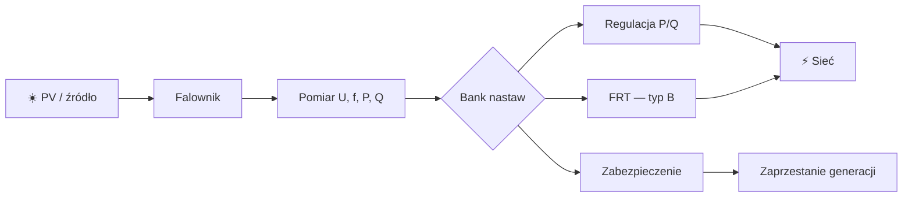

## Wielkości fizyczne na przykładach

> [!abstract] Co zrozumiesz?
> Po przeczytaniu powinieneś umieć wyjaśnić temat własnymi słowami i powiązać go z pomiarami oraz realnym zachowaniem falownika. To **materiał dydaktyczny**, nie zatwierdzona konfiguracja urządzenia.

### Schemat: jak elementy są połączone

**Uwaga do grafiki:** schemat jest uproszczony. Nie pokazuje odległości w skali ani wszystkich warunków pomiarowych. Diagramy Mermaid są rysowane bezpośrednio przez Obsidiana, bez zewnętrznych plików graficznych.

## 1. Napięcie skuteczne

### Co to znaczy po ludzku?
230 V to wartość skuteczna napięcia fazowego. W sinusoidzie wartość szczytowa jest większa o czynnik √2. Nie wolno mieszać wartości chwilowej, RMS i średniej 10-minutowej.

### Przykład do prześledzenia
230 V RMS ma amplitudę około 325 V dla czystej sinusoidy.

### Jak to rozpoznać w instalacji?
Wyobraź sobie, że stoisz przy rozdzielnicy i widzisz tylko wykres z analizatora oraz historię zdarzeń falownika. Zacznij od odczytu **jednostki i punktu pomiarowego**. Czy jest to napięcie fazowe, międzyfazowe, moc kW, moc kvar, czy częstotliwość Hz? Jeżeli widzisz wartość względną, zanotuj bazę. Potem porównaj sygnał **przed zdarzeniem**, **w trakcie** i **po zdarzeniu**. Przy parametrach typu »Napięcie skuteczne« nie zaczynaj od szukania winnego elementu: najpierw ustal, czy jest to wymaganie regulatora, czy zabezpieczenia, i czy w ogóle warunek wystąpił.

Praktyczna sekwencja diagnostyczna dla automatyka: **pomiary → aktywna funkcja → próg i metoda obliczeń → oczekiwane działanie → faktyczny stan → wniosek**. Jeśli brakuje jednego ogniwa, wynik powinien brzmieć »nie potwierdzono«, a nie »falownik działa źle«. To szczególnie ważne przy krótkotrwałych zdarzeniach, bo SCADA aktualizowana co sekundę może ich nie zapisać.

### Ćwiczenie bez ryzyka
1. Zapisz własnymi słowami, dlaczego termin **Napięcie skuteczne** jest istotny dla sieci. Nie przepisuj tabeli; opowiedz o fizycznym zjawisku.
2. Wypisz, które wielkości trzeba zmierzyć, aby stwierdzić, że zaszła opisana sytuacja.
3. Podaj, czego **nie da się** rozstrzygnąć z jednego odczytu lub zdjęcia ekranu.
4. Odpowiedz: jak odróżnisz zachowanie poprawne od awarii bez zmieniania żadnych nastaw?

> [!tip] Jedna rzecz do zapamiętania
> **Napięcie skuteczne**: 230 V RMS ma amplitudę około 325 V dla czystej sinusoidy.

## 2. Liniowe a fazowe

### Co to znaczy po ludzku?
W układzie symetrycznym 400 V międzyfazowo odpowiada około 230 V względem przewodu neutralnego. Należy uważać, do której wielkości odnosi się próg falownika.

### Przykład do prześledzenia
1,10×230 V = 253 V na napięciu fazowym.

### Jak to rozpoznać w instalacji?
Wyobraź sobie, że stoisz przy rozdzielnicy i widzisz tylko wykres z analizatora oraz historię zdarzeń falownika. Zacznij od odczytu **jednostki i punktu pomiarowego**. Czy jest to napięcie fazowe, międzyfazowe, moc kW, moc kvar, czy częstotliwość Hz? Jeżeli widzisz wartość względną, zanotuj bazę. Potem porównaj sygnał **przed zdarzeniem**, **w trakcie** i **po zdarzeniu**. Przy parametrach typu »Liniowe a fazowe« nie zaczynaj od szukania winnego elementu: najpierw ustal, czy jest to wymaganie regulatora, czy zabezpieczenia, i czy w ogóle warunek wystąpił.

Praktyczna sekwencja diagnostyczna dla automatyka: **pomiary → aktywna funkcja → próg i metoda obliczeń → oczekiwane działanie → faktyczny stan → wniosek**. Jeśli brakuje jednego ogniwa, wynik powinien brzmieć »nie potwierdzono«, a nie »falownik działa źle«. To szczególnie ważne przy krótkotrwałych zdarzeniach, bo SCADA aktualizowana co sekundę może ich nie zapisać.

### Ćwiczenie bez ryzyka
1. Zapisz własnymi słowami, dlaczego termin **Liniowe a fazowe** jest istotny dla sieci. Nie przepisuj tabeli; opowiedz o fizycznym zjawisku.
2. Wypisz, które wielkości trzeba zmierzyć, aby stwierdzić, że zaszła opisana sytuacja.
3. Podaj, czego **nie da się** rozstrzygnąć z jednego odczytu lub zdjęcia ekranu.
4. Odpowiedz: jak odróżnisz zachowanie poprawne od awarii bez zmieniania żadnych nastaw?

> [!tip] Jedna rzecz do zapamiętania
> **Liniowe a fazowe**: 1,10×230 V = 253 V na napięciu fazowym.

## 3. Per unit

### Co to znaczy po ludzku?
p.u. to normalizacja. Równanie U_pu=U/Ubase pozwala użyć jednej krzywej dla różnych poziomów napięcia. Sama liczba bez bazy jest niepełna.

### Przykład do prześledzenia
1,08 p.u.×230 V=248,4 V; ×15000 V=16200 V.

### Jak to rozpoznać w instalacji?
Wyobraź sobie, że stoisz przy rozdzielnicy i widzisz tylko wykres z analizatora oraz historię zdarzeń falownika. Zacznij od odczytu **jednostki i punktu pomiarowego**. Czy jest to napięcie fazowe, międzyfazowe, moc kW, moc kvar, czy częstotliwość Hz? Jeżeli widzisz wartość względną, zanotuj bazę. Potem porównaj sygnał **przed zdarzeniem**, **w trakcie** i **po zdarzeniu**. Przy parametrach typu »Per unit« nie zaczynaj od szukania winnego elementu: najpierw ustal, czy jest to wymaganie regulatora, czy zabezpieczenia, i czy w ogóle warunek wystąpił.

Praktyczna sekwencja diagnostyczna dla automatyka: **pomiary → aktywna funkcja → próg i metoda obliczeń → oczekiwane działanie → faktyczny stan → wniosek**. Jeśli brakuje jednego ogniwa, wynik powinien brzmieć »nie potwierdzono«, a nie »falownik działa źle«. To szczególnie ważne przy krótkotrwałych zdarzeniach, bo SCADA aktualizowana co sekundę może ich nie zapisać.

### Ćwiczenie bez ryzyka
1. Zapisz własnymi słowami, dlaczego termin **Per unit** jest istotny dla sieci. Nie przepisuj tabeli; opowiedz o fizycznym zjawisku.
2. Wypisz, które wielkości trzeba zmierzyć, aby stwierdzić, że zaszła opisana sytuacja.
3. Podaj, czego **nie da się** rozstrzygnąć z jednego odczytu lub zdjęcia ekranu.
4. Odpowiedz: jak odróżnisz zachowanie poprawne od awarii bez zmieniania żadnych nastaw?

> [!tip] Jedna rzecz do zapamiętania
> **Per unit**: 1,08 p.u.×230 V=248,4 V; ×15000 V=16200 V.

## 4. Częstotliwość

### Co to znaczy po ludzku?
50 Hz to 50 pełnych okresów na sekundę. Stabilność częstotliwości jest związana z równowagą mocy czynnej w systemie.

### Przykład do prześledzenia
Okres napięcia przy 50 Hz wynosi 20 ms.

### Jak to rozpoznać w instalacji?
Wyobraź sobie, że stoisz przy rozdzielnicy i widzisz tylko wykres z analizatora oraz historię zdarzeń falownika. Zacznij od odczytu **jednostki i punktu pomiarowego**. Czy jest to napięcie fazowe, międzyfazowe, moc kW, moc kvar, czy częstotliwość Hz? Jeżeli widzisz wartość względną, zanotuj bazę. Potem porównaj sygnał **przed zdarzeniem**, **w trakcie** i **po zdarzeniu**. Przy parametrach typu »Częstotliwość« nie zaczynaj od szukania winnego elementu: najpierw ustal, czy jest to wymaganie regulatora, czy zabezpieczenia, i czy w ogóle warunek wystąpił.

Praktyczna sekwencja diagnostyczna dla automatyka: **pomiary → aktywna funkcja → próg i metoda obliczeń → oczekiwane działanie → faktyczny stan → wniosek**. Jeśli brakuje jednego ogniwa, wynik powinien brzmieć »nie potwierdzono«, a nie »falownik działa źle«. To szczególnie ważne przy krótkotrwałych zdarzeniach, bo SCADA aktualizowana co sekundę może ich nie zapisać.

### Ćwiczenie bez ryzyka
1. Zapisz własnymi słowami, dlaczego termin **Częstotliwość** jest istotny dla sieci. Nie przepisuj tabeli; opowiedz o fizycznym zjawisku.
2. Wypisz, które wielkości trzeba zmierzyć, aby stwierdzić, że zaszła opisana sytuacja.
3. Podaj, czego **nie da się** rozstrzygnąć z jednego odczytu lub zdjęcia ekranu.
4. Odpowiedz: jak odróżnisz zachowanie poprawne od awarii bez zmieniania żadnych nastaw?

> [!tip] Jedna rzecz do zapamiętania
> **Częstotliwość**: Okres napięcia przy 50 Hz wynosi 20 ms.

## 5. RoCoF

### Co to znaczy po ludzku?
RoCoF to tempo zmiany częstotliwości w Hz/s. Wyliczając różnicę dwóch próbek, trzeba brać pod uwagę filtrację i szum pomiaru.

### Przykład do prześledzenia
Zmiana 50,0→50,2 Hz w 0,1 s daje iloraz różnicowy 2 Hz/s.

### Jak to rozpoznać w instalacji?
Wyobraź sobie, że stoisz przy rozdzielnicy i widzisz tylko wykres z analizatora oraz historię zdarzeń falownika. Zacznij od odczytu **jednostki i punktu pomiarowego**. Czy jest to napięcie fazowe, międzyfazowe, moc kW, moc kvar, czy częstotliwość Hz? Jeżeli widzisz wartość względną, zanotuj bazę. Potem porównaj sygnał **przed zdarzeniem**, **w trakcie** i **po zdarzeniu**. Przy parametrach typu »RoCoF« nie zaczynaj od szukania winnego elementu: najpierw ustal, czy jest to wymaganie regulatora, czy zabezpieczenia, i czy w ogóle warunek wystąpił.

Praktyczna sekwencja diagnostyczna dla automatyka: **pomiary → aktywna funkcja → próg i metoda obliczeń → oczekiwane działanie → faktyczny stan → wniosek**. Jeśli brakuje jednego ogniwa, wynik powinien brzmieć »nie potwierdzono«, a nie »falownik działa źle«. To szczególnie ważne przy krótkotrwałych zdarzeniach, bo SCADA aktualizowana co sekundę może ich nie zapisać.

### Ćwiczenie bez ryzyka
1. Zapisz własnymi słowami, dlaczego termin **RoCoF** jest istotny dla sieci. Nie przepisuj tabeli; opowiedz o fizycznym zjawisku.
2. Wypisz, które wielkości trzeba zmierzyć, aby stwierdzić, że zaszła opisana sytuacja.
3. Podaj, czego **nie da się** rozstrzygnąć z jednego odczytu lub zdjęcia ekranu.
4. Odpowiedz: jak odróżnisz zachowanie poprawne od awarii bez zmieniania żadnych nastaw?

> [!tip] Jedna rzecz do zapamiętania
> **RoCoF**: Zmiana 50,0→50,2 Hz w 0,1 s daje iloraz różnicowy 2 Hz/s.

## 6. Moc czynna

### Co to znaczy po ludzku?
P [kW] opisuje średni przepływ energii użytecznej. Energia [kWh] to całka mocy w czasie. W PV moc zmienia się z nasłonecznieniem i ograniczeniem falownika.

### Przykład do prześledzenia
Stałe 4 kW przez 3 h daje 12 kWh.

### Jak to rozpoznać w instalacji?
Wyobraź sobie, że stoisz przy rozdzielnicy i widzisz tylko wykres z analizatora oraz historię zdarzeń falownika. Zacznij od odczytu **jednostki i punktu pomiarowego**. Czy jest to napięcie fazowe, międzyfazowe, moc kW, moc kvar, czy częstotliwość Hz? Jeżeli widzisz wartość względną, zanotuj bazę. Potem porównaj sygnał **przed zdarzeniem**, **w trakcie** i **po zdarzeniu**. Przy parametrach typu »Moc czynna« nie zaczynaj od szukania winnego elementu: najpierw ustal, czy jest to wymaganie regulatora, czy zabezpieczenia, i czy w ogóle warunek wystąpił.

Praktyczna sekwencja diagnostyczna dla automatyka: **pomiary → aktywna funkcja → próg i metoda obliczeń → oczekiwane działanie → faktyczny stan → wniosek**. Jeśli brakuje jednego ogniwa, wynik powinien brzmieć »nie potwierdzono«, a nie »falownik działa źle«. To szczególnie ważne przy krótkotrwałych zdarzeniach, bo SCADA aktualizowana co sekundę może ich nie zapisać.

### Ćwiczenie bez ryzyka
1. Zapisz własnymi słowami, dlaczego termin **Moc czynna** jest istotny dla sieci. Nie przepisuj tabeli; opowiedz o fizycznym zjawisku.
2. Wypisz, które wielkości trzeba zmierzyć, aby stwierdzić, że zaszła opisana sytuacja.
3. Podaj, czego **nie da się** rozstrzygnąć z jednego odczytu lub zdjęcia ekranu.
4. Odpowiedz: jak odróżnisz zachowanie poprawne od awarii bez zmieniania żadnych nastaw?

> [!tip] Jedna rzecz do zapamiętania
> **Moc czynna**: Stałe 4 kW przez 3 h daje 12 kWh.

## 7. Moc bierna

### Co to znaczy po ludzku?
Q [kvar] opisuje oscylacyjną wymianę energii w polach elektrycznych i magnetycznych w typowych warunkach AC. Wpływa na napięcie i obciążenie prądowe sieci.

### Przykład do prześledzenia
Falownik może zmienić Q mimo braku zmiany P.

### Jak to rozpoznać w instalacji?
Wyobraź sobie, że stoisz przy rozdzielnicy i widzisz tylko wykres z analizatora oraz historię zdarzeń falownika. Zacznij od odczytu **jednostki i punktu pomiarowego**. Czy jest to napięcie fazowe, międzyfazowe, moc kW, moc kvar, czy częstotliwość Hz? Jeżeli widzisz wartość względną, zanotuj bazę. Potem porównaj sygnał **przed zdarzeniem**, **w trakcie** i **po zdarzeniu**. Przy parametrach typu »Moc bierna« nie zaczynaj od szukania winnego elementu: najpierw ustal, czy jest to wymaganie regulatora, czy zabezpieczenia, i czy w ogóle warunek wystąpił.

Praktyczna sekwencja diagnostyczna dla automatyka: **pomiary → aktywna funkcja → próg i metoda obliczeń → oczekiwane działanie → faktyczny stan → wniosek**. Jeśli brakuje jednego ogniwa, wynik powinien brzmieć »nie potwierdzono«, a nie »falownik działa źle«. To szczególnie ważne przy krótkotrwałych zdarzeniach, bo SCADA aktualizowana co sekundę może ich nie zapisać.

### Ćwiczenie bez ryzyka
1. Zapisz własnymi słowami, dlaczego termin **Moc bierna** jest istotny dla sieci. Nie przepisuj tabeli; opowiedz o fizycznym zjawisku.
2. Wypisz, które wielkości trzeba zmierzyć, aby stwierdzić, że zaszła opisana sytuacja.
3. Podaj, czego **nie da się** rozstrzygnąć z jednego odczytu lub zdjęcia ekranu.
4. Odpowiedz: jak odróżnisz zachowanie poprawne od awarii bez zmieniania żadnych nastaw?

> [!tip] Jedna rzecz do zapamiętania
> **Moc bierna**: Falownik może zmienić Q mimo braku zmiany P.

## 8. Moc pozorna

### Co to znaczy po ludzku?
S [kVA] wiąże się z prądem. Przy przebiegach sinusoidalnych S²=P²+Q². Nie można żądać jednocześnie dowolnego P i Q od urządzenia o ustalonym limicie prądu.

### Przykład do prześledzenia
P=8 kW, S=10 kVA → |Q|max≈6 kvar.

### Jak to rozpoznać w instalacji?
Wyobraź sobie, że stoisz przy rozdzielnicy i widzisz tylko wykres z analizatora oraz historię zdarzeń falownika. Zacznij od odczytu **jednostki i punktu pomiarowego**. Czy jest to napięcie fazowe, międzyfazowe, moc kW, moc kvar, czy częstotliwość Hz? Jeżeli widzisz wartość względną, zanotuj bazę. Potem porównaj sygnał **przed zdarzeniem**, **w trakcie** i **po zdarzeniu**. Przy parametrach typu »Moc pozorna« nie zaczynaj od szukania winnego elementu: najpierw ustal, czy jest to wymaganie regulatora, czy zabezpieczenia, i czy w ogóle warunek wystąpił.

Praktyczna sekwencja diagnostyczna dla automatyka: **pomiary → aktywna funkcja → próg i metoda obliczeń → oczekiwane działanie → faktyczny stan → wniosek**. Jeśli brakuje jednego ogniwa, wynik powinien brzmieć »nie potwierdzono«, a nie »falownik działa źle«. To szczególnie ważne przy krótkotrwałych zdarzeniach, bo SCADA aktualizowana co sekundę może ich nie zapisać.

### Ćwiczenie bez ryzyka
1. Zapisz własnymi słowami, dlaczego termin **Moc pozorna** jest istotny dla sieci. Nie przepisuj tabeli; opowiedz o fizycznym zjawisku.
2. Wypisz, które wielkości trzeba zmierzyć, aby stwierdzić, że zaszła opisana sytuacja.
3. Podaj, czego **nie da się** rozstrzygnąć z jednego odczytu lub zdjęcia ekranu.
4. Odpowiedz: jak odróżnisz zachowanie poprawne od awarii bez zmieniania żadnych nastaw?

> [!tip] Jedna rzecz do zapamiętania
> **Moc pozorna**: P=8 kW, S=10 kVA → |Q|max≈6 kvar.

## 9. cosφ

### Co to znaczy po ludzku?
cosφ opisuje relację P i S w sinusoidalnym stanie ustalonym. Związek Q/P=tan(arccos(cosφ)) wyjaśnia skąd bierze się 0,4843 przy cosφ=0,9.

### Przykład do prześledzenia
0,4843×10 kW=4,843 kvar.

### Jak to rozpoznać w instalacji?
Wyobraź sobie, że stoisz przy rozdzielnicy i widzisz tylko wykres z analizatora oraz historię zdarzeń falownika. Zacznij od odczytu **jednostki i punktu pomiarowego**. Czy jest to napięcie fazowe, międzyfazowe, moc kW, moc kvar, czy częstotliwość Hz? Jeżeli widzisz wartość względną, zanotuj bazę. Potem porównaj sygnał **przed zdarzeniem**, **w trakcie** i **po zdarzeniu**. Przy parametrach typu »cosφ« nie zaczynaj od szukania winnego elementu: najpierw ustal, czy jest to wymaganie regulatora, czy zabezpieczenia, i czy w ogóle warunek wystąpił.

Praktyczna sekwencja diagnostyczna dla automatyka: **pomiary → aktywna funkcja → próg i metoda obliczeń → oczekiwane działanie → faktyczny stan → wniosek**. Jeśli brakuje jednego ogniwa, wynik powinien brzmieć »nie potwierdzono«, a nie »falownik działa źle«. To szczególnie ważne przy krótkotrwałych zdarzeniach, bo SCADA aktualizowana co sekundę może ich nie zapisać.

### Ćwiczenie bez ryzyka
1. Zapisz własnymi słowami, dlaczego termin **cosφ** jest istotny dla sieci. Nie przepisuj tabeli; opowiedz o fizycznym zjawisku.
2. Wypisz, które wielkości trzeba zmierzyć, aby stwierdzić, że zaszła opisana sytuacja.
3. Podaj, czego **nie da się** rozstrzygnąć z jednego odczytu lub zdjęcia ekranu.
4. Odpowiedz: jak odróżnisz zachowanie poprawne od awarii bez zmieniania żadnych nastaw?

> [!tip] Jedna rzecz do zapamiętania
> **cosφ**: 0,4843×10 kW=4,843 kvar.

## 10. Konwencja znaku Q

### Co to znaczy po ludzku?
Znak Q w menu falownika nie zawsze odpowiada temu samemu kierunkowi wymiany mocy co znak Q w SCADA. Projekt powinien jednoznacznie definiować pobór/generację.

### Przykład do prześledzenia
Przed uruchomieniem regulatora sprawdź fizyczny kierunek Q na analizatorze w PCC.

### Jak to rozpoznać w instalacji?
Wyobraź sobie, że stoisz przy rozdzielnicy i widzisz tylko wykres z analizatora oraz historię zdarzeń falownika. Zacznij od odczytu **jednostki i punktu pomiarowego**. Czy jest to napięcie fazowe, międzyfazowe, moc kW, moc kvar, czy częstotliwość Hz? Jeżeli widzisz wartość względną, zanotuj bazę. Potem porównaj sygnał **przed zdarzeniem**, **w trakcie** i **po zdarzeniu**. Przy parametrach typu »Konwencja znaku Q« nie zaczynaj od szukania winnego elementu: najpierw ustal, czy jest to wymaganie regulatora, czy zabezpieczenia, i czy w ogóle warunek wystąpił.

Praktyczna sekwencja diagnostyczna dla automatyka: **pomiary → aktywna funkcja → próg i metoda obliczeń → oczekiwane działanie → faktyczny stan → wniosek**. Jeśli brakuje jednego ogniwa, wynik powinien brzmieć »nie potwierdzono«, a nie »falownik działa źle«. To szczególnie ważne przy krótkotrwałych zdarzeniach, bo SCADA aktualizowana co sekundę może ich nie zapisać.

### Ćwiczenie bez ryzyka
1. Zapisz własnymi słowami, dlaczego termin **Konwencja znaku Q** jest istotny dla sieci. Nie przepisuj tabeli; opowiedz o fizycznym zjawisku.
2. Wypisz, które wielkości trzeba zmierzyć, aby stwierdzić, że zaszła opisana sytuacja.
3. Podaj, czego **nie da się** rozstrzygnąć z jednego odczytu lub zdjęcia ekranu.
4. Odpowiedz: jak odróżnisz zachowanie poprawne od awarii bez zmieniania żadnych nastaw?

> [!tip] Jedna rzecz do zapamiętania
> **Konwencja znaku Q**: Przed uruchomieniem regulatora sprawdź fizyczny kierunek Q na analizatorze w PCC.

## Studium przypadków: od schematu do wniosku

### Scenariusz 1: Napięcie skuteczne
Masz zadanie sprawdzić instalację, w której operator zgłosił nietypowe zachowanie związane z obszarem **Napięcie skuteczne**. W pierwszym kroku nie zmieniasz konfiguracji. Przygotowujesz zestaw danych: topologię przyłączenia, wartości znamionowe i bazy, historię U/f/P/Q, znaczniki czasu, stany sterowania nadrzędnego i kody zdarzeń. **Hipoteza robocza:** 230 V to wartość skuteczna napięcia fazowego. W sinusoidzie wartość szczytowa jest większa o czynnik √2. Nie wolno mieszać wartości chwilowej, RMS i średniej 10-minutowej. Zestaw tę hipotezę z obserwacją: 230 V RMS ma amplitudę około 325 V dla czystej sinusoidy. Następnie odpowiedz, co potwierdza wymaganie dokumentu, a co jest tylko możliwym zachowaniem konkretnego urządzenia. Gdy pojawia się sprzeczność, sprawdź najpierw jednostki i kierunki przepływu, dopiero potem oceniaj oprogramowanie. Zakończ tabelą: obserwacja, oczekiwane zachowanie, źródło wymagania, dane brakujące, werdykt. Nie wykonuj prób zwarciowych ani zmiany zabezpieczeń w czynnej instalacji.

### Scenariusz 2: Liniowe a fazowe
Masz zadanie sprawdzić instalację, w której operator zgłosił nietypowe zachowanie związane z obszarem **Liniowe a fazowe**. W pierwszym kroku nie zmieniasz konfiguracji. Przygotowujesz zestaw danych: topologię przyłączenia, wartości znamionowe i bazy, historię U/f/P/Q, znaczniki czasu, stany sterowania nadrzędnego i kody zdarzeń. **Hipoteza robocza:** W układzie symetrycznym 400 V międzyfazowo odpowiada około 230 V względem przewodu neutralnego. Należy uważać, do której wielkości odnosi się próg falownika. Zestaw tę hipotezę z obserwacją: 1,10×230 V = 253 V na napięciu fazowym. Następnie odpowiedz, co potwierdza wymaganie dokumentu, a co jest tylko możliwym zachowaniem konkretnego urządzenia. Gdy pojawia się sprzeczność, sprawdź najpierw jednostki i kierunki przepływu, dopiero potem oceniaj oprogramowanie. Zakończ tabelą: obserwacja, oczekiwane zachowanie, źródło wymagania, dane brakujące, werdykt. Nie wykonuj prób zwarciowych ani zmiany zabezpieczeń w czynnej instalacji.

### Scenariusz 3: Per unit
Masz zadanie sprawdzić instalację, w której operator zgłosił nietypowe zachowanie związane z obszarem **Per unit**. W pierwszym kroku nie zmieniasz konfiguracji. Przygotowujesz zestaw danych: topologię przyłączenia, wartości znamionowe i bazy, historię U/f/P/Q, znaczniki czasu, stany sterowania nadrzędnego i kody zdarzeń. **Hipoteza robocza:** p.u. to normalizacja. Równanie U_pu=U/Ubase pozwala użyć jednej krzywej dla różnych poziomów napięcia. Sama liczba bez bazy jest niepełna. Zestaw tę hipotezę z obserwacją: 1,08 p.u.×230 V=248,4 V; ×15000 V=16200 V. Następnie odpowiedz, co potwierdza wymaganie dokumentu, a co jest tylko możliwym zachowaniem konkretnego urządzenia. Gdy pojawia się sprzeczność, sprawdź najpierw jednostki i kierunki przepływu, dopiero potem oceniaj oprogramowanie. Zakończ tabelą: obserwacja, oczekiwane zachowanie, źródło wymagania, dane brakujące, werdykt. Nie wykonuj prób zwarciowych ani zmiany zabezpieczeń w czynnej instalacji.

### Scenariusz 4: Częstotliwość
Masz zadanie sprawdzić instalację, w której operator zgłosił nietypowe zachowanie związane z obszarem **Częstotliwość**. W pierwszym kroku nie zmieniasz konfiguracji. Przygotowujesz zestaw danych: topologię przyłączenia, wartości znamionowe i bazy, historię U/f/P/Q, znaczniki czasu, stany sterowania nadrzędnego i kody zdarzeń. **Hipoteza robocza:** 50 Hz to 50 pełnych okresów na sekundę. Stabilność częstotliwości jest związana z równowagą mocy czynnej w systemie. Zestaw tę hipotezę z obserwacją: Okres napięcia przy 50 Hz wynosi 20 ms. Następnie odpowiedz, co potwierdza wymaganie dokumentu, a co jest tylko możliwym zachowaniem konkretnego urządzenia. Gdy pojawia się sprzeczność, sprawdź najpierw jednostki i kierunki przepływu, dopiero potem oceniaj oprogramowanie. Zakończ tabelą: obserwacja, oczekiwane zachowanie, źródło wymagania, dane brakujące, werdykt. Nie wykonuj prób zwarciowych ani zmiany zabezpieczeń w czynnej instalacji.

### Scenariusz 5: RoCoF
Masz zadanie sprawdzić instalację, w której operator zgłosił nietypowe zachowanie związane z obszarem **RoCoF**. W pierwszym kroku nie zmieniasz konfiguracji. Przygotowujesz zestaw danych: topologię przyłączenia, wartości znamionowe i bazy, historię U/f/P/Q, znaczniki czasu, stany sterowania nadrzędnego i kody zdarzeń. **Hipoteza robocza:** RoCoF to tempo zmiany częstotliwości w Hz/s. Wyliczając różnicę dwóch próbek, trzeba brać pod uwagę filtrację i szum pomiaru. Zestaw tę hipotezę z obserwacją: Zmiana 50,0→50,2 Hz w 0,1 s daje iloraz różnicowy 2 Hz/s. Następnie odpowiedz, co potwierdza wymaganie dokumentu, a co jest tylko możliwym zachowaniem konkretnego urządzenia. Gdy pojawia się sprzeczność, sprawdź najpierw jednostki i kierunki przepływu, dopiero potem oceniaj oprogramowanie. Zakończ tabelą: obserwacja, oczekiwane zachowanie, źródło wymagania, dane brakujące, werdykt. Nie wykonuj prób zwarciowych ani zmiany zabezpieczeń w czynnej instalacji.

### Scenariusz 6: Moc czynna
Masz zadanie sprawdzić instalację, w której operator zgłosił nietypowe zachowanie związane z obszarem **Moc czynna**. W pierwszym kroku nie zmieniasz konfiguracji. Przygotowujesz zestaw danych: topologię przyłączenia, wartości znamionowe i bazy, historię U/f/P/Q, znaczniki czasu, stany sterowania nadrzędnego i kody zdarzeń. **Hipoteza robocza:** P [kW] opisuje średni przepływ energii użytecznej. Energia [kWh] to całka mocy w czasie. W PV moc zmienia się z nasłonecznieniem i ograniczeniem falownika. Zestaw tę hipotezę z obserwacją: Stałe 4 kW przez 3 h daje 12 kWh. Następnie odpowiedz, co potwierdza wymaganie dokumentu, a co jest tylko możliwym zachowaniem konkretnego urządzenia. Gdy pojawia się sprzeczność, sprawdź najpierw jednostki i kierunki przepływu, dopiero potem oceniaj oprogramowanie. Zakończ tabelą: obserwacja, oczekiwane zachowanie, źródło wymagania, dane brakujące, werdykt. Nie wykonuj prób zwarciowych ani zmiany zabezpieczeń w czynnej instalacji.

### Scenariusz 7: Moc bierna
Masz zadanie sprawdzić instalację, w której operator zgłosił nietypowe zachowanie związane z obszarem **Moc bierna**. W pierwszym kroku nie zmieniasz konfiguracji. Przygotowujesz zestaw danych: topologię przyłączenia, wartości znamionowe i bazy, historię U/f/P/Q, znaczniki czasu, stany sterowania nadrzędnego i kody zdarzeń. **Hipoteza robocza:** Q [kvar] opisuje oscylacyjną wymianę energii w polach elektrycznych i magnetycznych w typowych warunkach AC. Wpływa na napięcie i obciążenie prądowe sieci. Zestaw tę hipotezę z obserwacją: Falownik może zmienić Q mimo braku zmiany P. Następnie odpowiedz, co potwierdza wymaganie dokumentu, a co jest tylko możliwym zachowaniem konkretnego urządzenia. Gdy pojawia się sprzeczność, sprawdź najpierw jednostki i kierunki przepływu, dopiero potem oceniaj oprogramowanie. Zakończ tabelą: obserwacja, oczekiwane zachowanie, źródło wymagania, dane brakujące, werdykt. Nie wykonuj prób zwarciowych ani zmiany zabezpieczeń w czynnej instalacji.

### Scenariusz 8: Moc pozorna
Masz zadanie sprawdzić instalację, w której operator zgłosił nietypowe zachowanie związane z obszarem **Moc pozorna**. W pierwszym kroku nie zmieniasz konfiguracji. Przygotowujesz zestaw danych: topologię przyłączenia, wartości znamionowe i bazy, historię U/f/P/Q, znaczniki czasu, stany sterowania nadrzędnego i kody zdarzeń. **Hipoteza robocza:** S [kVA] wiąże się z prądem. Przy przebiegach sinusoidalnych S²=P²+Q². Nie można żądać jednocześnie dowolnego P i Q od urządzenia o ustalonym limicie prądu. Zestaw tę hipotezę z obserwacją: P=8 kW, S=10 kVA → |Q|max≈6 kvar. Następnie odpowiedz, co potwierdza wymaganie dokumentu, a co jest tylko możliwym zachowaniem konkretnego urządzenia. Gdy pojawia się sprzeczność, sprawdź najpierw jednostki i kierunki przepływu, dopiero potem oceniaj oprogramowanie. Zakończ tabelą: obserwacja, oczekiwane zachowanie, źródło wymagania, dane brakujące, werdykt. Nie wykonuj prób zwarciowych ani zmiany zabezpieczeń w czynnej instalacji.

## Koniec rozdziału — pięć pytań
1. Jakie fizyczne zjawisko omawia ten rozdział?
2. Kiedy urządzenie powinno **regulować moc**, a kiedy działać ochronnie?
3. Który sygnał trzeba sprawdzić w PLC/SCADA i z jaką rozdzielczością czasową?
4. Jakie dane o urządzeniu i sieci trzeba ustalić przed oceną zdarzenia?
5. Co stanowi wymaganie literalne PTPiREE, a co jest jedynie objaśnieniem dydaktycznym?

Źródło: [PTPiREE – Bank Nastaw dla Polski, wersja 1.1, 01.10.2024](https://ptpiree.pl/wp-content/uploads/2024/12/bn_2024_10_01-1.pdf). Szczegółowe wykresy i przypisy sprawdź w źródłowym PDF.
