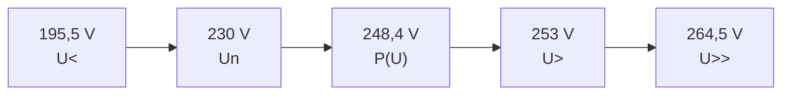

## Kiedy falownik zaprzestaje generacji

> [!abstract] Co zrozumiesz?
> Po przeczytaniu powinieneś umieć wyjaśnić temat własnymi słowami i powiązać go z pomiarami oraz realnym zachowaniem falownika. To **materiał dydaktyczny**, nie zatwierdzona konfiguracja urządzenia.

### Schemat: jak elementy są połączone

**Uwaga do grafiki:** schemat jest uproszczony. Nie pokazuje odległości w skali ani wszystkich warunków pomiarowych. Diagramy Mermaid są rysowane bezpośrednio przez Obsidiana, bez zewnętrznych plików graficznych.

## 1. U<

### Co to znaczy po ludzku?
Ochrona podnapięciowa typu A jest ustawiona na 0,85 Un i zwłokę 1,2 s. Przy Un=230 V próg to 195,5 V. Jest to oddzielne kryterium od chwilowego spadku podczas zwarcia w typie B.

### Przykład do prześledzenia
W logu widzisz 192 V przez ponad sekundę. Sprawdź metodę pomiaru i stan U<.

### Jak to rozpoznać w instalacji?
Wyobraź sobie, że stoisz przy rozdzielnicy i widzisz tylko wykres z analizatora oraz historię zdarzeń falownika. Zacznij od odczytu **jednostki i punktu pomiarowego**. Czy jest to napięcie fazowe, międzyfazowe, moc kW, moc kvar, czy częstotliwość Hz? Jeżeli widzisz wartość względną, zanotuj bazę. Potem porównaj sygnał **przed zdarzeniem**, **w trakcie** i **po zdarzeniu**. Przy parametrach typu »U<« nie zaczynaj od szukania winnego elementu: najpierw ustal, czy jest to wymaganie regulatora, czy zabezpieczenia, i czy w ogóle warunek wystąpił.

Praktyczna sekwencja diagnostyczna dla automatyka: **pomiary → aktywna funkcja → próg i metoda obliczeń → oczekiwane działanie → faktyczny stan → wniosek**. Jeśli brakuje jednego ogniwa, wynik powinien brzmieć »nie potwierdzono«, a nie »falownik działa źle«. To szczególnie ważne przy krótkotrwałych zdarzeniach, bo SCADA aktualizowana co sekundę może ich nie zapisać.

### Ćwiczenie bez ryzyka
1. Zapisz własnymi słowami, dlaczego termin **U<** jest istotny dla sieci. Nie przepisuj tabeli; opowiedz o fizycznym zjawisku.
2. Wypisz, które wielkości trzeba zmierzyć, aby stwierdzić, że zaszła opisana sytuacja.
3. Podaj, czego **nie da się** rozstrzygnąć z jednego odczytu lub zdjęcia ekranu.
4. Odpowiedz: jak odróżnisz zachowanie poprawne od awarii bez zmieniania żadnych nastaw?

> [!tip] Jedna rzecz do zapamiętania
> **U<**: W logu widzisz 192 V przez ponad sekundę. Sprawdź metodę pomiaru i stan U<.

## 2. U>

### Co to znaczy po ludzku?
Pierwszy stopień nadnapięcia ma próg 1,10 Un = 253 V i zwłokę 3 s. Przypis do dokumentu podkreśla 10-minutową średnią w oknie przesuwnym; pojedynczy pik na multimetrze nie wystarczy do diagnozy.

### Przykład do prześledzenia
Odczyt 254 V przez 5 s nie dowodzi spełnienia kryterium 10-minutowego.

### Jak to rozpoznać w instalacji?
Wyobraź sobie, że stoisz przy rozdzielnicy i widzisz tylko wykres z analizatora oraz historię zdarzeń falownika. Zacznij od odczytu **jednostki i punktu pomiarowego**. Czy jest to napięcie fazowe, międzyfazowe, moc kW, moc kvar, czy częstotliwość Hz? Jeżeli widzisz wartość względną, zanotuj bazę. Potem porównaj sygnał **przed zdarzeniem**, **w trakcie** i **po zdarzeniu**. Przy parametrach typu »U>« nie zaczynaj od szukania winnego elementu: najpierw ustal, czy jest to wymaganie regulatora, czy zabezpieczenia, i czy w ogóle warunek wystąpił.

Praktyczna sekwencja diagnostyczna dla automatyka: **pomiary → aktywna funkcja → próg i metoda obliczeń → oczekiwane działanie → faktyczny stan → wniosek**. Jeśli brakuje jednego ogniwa, wynik powinien brzmieć »nie potwierdzono«, a nie »falownik działa źle«. To szczególnie ważne przy krótkotrwałych zdarzeniach, bo SCADA aktualizowana co sekundę może ich nie zapisać.

### Ćwiczenie bez ryzyka
1. Zapisz własnymi słowami, dlaczego termin **U>** jest istotny dla sieci. Nie przepisuj tabeli; opowiedz o fizycznym zjawisku.
2. Wypisz, które wielkości trzeba zmierzyć, aby stwierdzić, że zaszła opisana sytuacja.
3. Podaj, czego **nie da się** rozstrzygnąć z jednego odczytu lub zdjęcia ekranu.
4. Odpowiedz: jak odróżnisz zachowanie poprawne od awarii bez zmieniania żadnych nastaw?

> [!tip] Jedna rzecz do zapamiętania
> **U>**: Odczyt 254 V przez 5 s nie dowodzi spełnienia kryterium 10-minutowego.

## 3. U>>

### Co to znaczy po ludzku?
Drugi stopień ma próg 1,15 Un = 264,5 V i zwłokę 0,1 s. Jest szybki: rejestrator z próbką co minutę nie pokaże przebiegu w czasie działania.

### Przykład do prześledzenia
Przy 267 V utrzymanym ponad 100 ms należy przeanalizować zdarzenie U>>.

### Jak to rozpoznać w instalacji?
Wyobraź sobie, że stoisz przy rozdzielnicy i widzisz tylko wykres z analizatora oraz historię zdarzeń falownika. Zacznij od odczytu **jednostki i punktu pomiarowego**. Czy jest to napięcie fazowe, międzyfazowe, moc kW, moc kvar, czy częstotliwość Hz? Jeżeli widzisz wartość względną, zanotuj bazę. Potem porównaj sygnał **przed zdarzeniem**, **w trakcie** i **po zdarzeniu**. Przy parametrach typu »U>>« nie zaczynaj od szukania winnego elementu: najpierw ustal, czy jest to wymaganie regulatora, czy zabezpieczenia, i czy w ogóle warunek wystąpił.

Praktyczna sekwencja diagnostyczna dla automatyka: **pomiary → aktywna funkcja → próg i metoda obliczeń → oczekiwane działanie → faktyczny stan → wniosek**. Jeśli brakuje jednego ogniwa, wynik powinien brzmieć »nie potwierdzono«, a nie »falownik działa źle«. To szczególnie ważne przy krótkotrwałych zdarzeniach, bo SCADA aktualizowana co sekundę może ich nie zapisać.

### Ćwiczenie bez ryzyka
1. Zapisz własnymi słowami, dlaczego termin **U>>** jest istotny dla sieci. Nie przepisuj tabeli; opowiedz o fizycznym zjawisku.
2. Wypisz, które wielkości trzeba zmierzyć, aby stwierdzić, że zaszła opisana sytuacja.
3. Podaj, czego **nie da się** rozstrzygnąć z jednego odczytu lub zdjęcia ekranu.
4. Odpowiedz: jak odróżnisz zachowanie poprawne od awarii bez zmieniania żadnych nastaw?

> [!tip] Jedna rzecz do zapamiętania
> **U>>**: Przy 267 V utrzymanym ponad 100 ms należy przeanalizować zdarzenie U>>.

## 4. f<

### Co to znaczy po ludzku?
Podczęstotliwość 47,5 Hz i zwłoka 1 s oznacza kryterium ochronne. Nie należy mylić go z regułą ograniczania mocy poniżej 49 Hz.

### Przykład do prześledzenia
48,8 Hz jest niżej niż 49, ale nie poniżej 47,5 Hz.

### Jak to rozpoznać w instalacji?
Wyobraź sobie, że stoisz przy rozdzielnicy i widzisz tylko wykres z analizatora oraz historię zdarzeń falownika. Zacznij od odczytu **jednostki i punktu pomiarowego**. Czy jest to napięcie fazowe, międzyfazowe, moc kW, moc kvar, czy częstotliwość Hz? Jeżeli widzisz wartość względną, zanotuj bazę. Potem porównaj sygnał **przed zdarzeniem**, **w trakcie** i **po zdarzeniu**. Przy parametrach typu »f<« nie zaczynaj od szukania winnego elementu: najpierw ustal, czy jest to wymaganie regulatora, czy zabezpieczenia, i czy w ogóle warunek wystąpił.

Praktyczna sekwencja diagnostyczna dla automatyka: **pomiary → aktywna funkcja → próg i metoda obliczeń → oczekiwane działanie → faktyczny stan → wniosek**. Jeśli brakuje jednego ogniwa, wynik powinien brzmieć »nie potwierdzono«, a nie »falownik działa źle«. To szczególnie ważne przy krótkotrwałych zdarzeniach, bo SCADA aktualizowana co sekundę może ich nie zapisać.

### Ćwiczenie bez ryzyka
1. Zapisz własnymi słowami, dlaczego termin **f<** jest istotny dla sieci. Nie przepisuj tabeli; opowiedz o fizycznym zjawisku.
2. Wypisz, które wielkości trzeba zmierzyć, aby stwierdzić, że zaszła opisana sytuacja.
3. Podaj, czego **nie da się** rozstrzygnąć z jednego odczytu lub zdjęcia ekranu.
4. Odpowiedz: jak odróżnisz zachowanie poprawne od awarii bez zmieniania żadnych nastaw?

> [!tip] Jedna rzecz do zapamiętania
> **f<**: 48,8 Hz jest niżej niż 49, ale nie poniżej 47,5 Hz.

## 5. f>

### Co to znaczy po ludzku?
Nadczęstotliwość 51,5 Hz ze zwłoką 0,3 s ma inne zadanie niż LFSM-O od 50,2 Hz.

### Przykład do prześledzenia
50,4 Hz to obszar działania regulacji, a nie osiągnięty próg f>.

### Jak to rozpoznać w instalacji?
Wyobraź sobie, że stoisz przy rozdzielnicy i widzisz tylko wykres z analizatora oraz historię zdarzeń falownika. Zacznij od odczytu **jednostki i punktu pomiarowego**. Czy jest to napięcie fazowe, międzyfazowe, moc kW, moc kvar, czy częstotliwość Hz? Jeżeli widzisz wartość względną, zanotuj bazę. Potem porównaj sygnał **przed zdarzeniem**, **w trakcie** i **po zdarzeniu**. Przy parametrach typu »f>« nie zaczynaj od szukania winnego elementu: najpierw ustal, czy jest to wymaganie regulatora, czy zabezpieczenia, i czy w ogóle warunek wystąpił.

Praktyczna sekwencja diagnostyczna dla automatyka: **pomiary → aktywna funkcja → próg i metoda obliczeń → oczekiwane działanie → faktyczny stan → wniosek**. Jeśli brakuje jednego ogniwa, wynik powinien brzmieć »nie potwierdzono«, a nie »falownik działa źle«. To szczególnie ważne przy krótkotrwałych zdarzeniach, bo SCADA aktualizowana co sekundę może ich nie zapisać.

### Ćwiczenie bez ryzyka
1. Zapisz własnymi słowami, dlaczego termin **f>** jest istotny dla sieci. Nie przepisuj tabeli; opowiedz o fizycznym zjawisku.
2. Wypisz, które wielkości trzeba zmierzyć, aby stwierdzić, że zaszła opisana sytuacja.
3. Podaj, czego **nie da się** rozstrzygnąć z jednego odczytu lub zdjęcia ekranu.
4. Odpowiedz: jak odróżnisz zachowanie poprawne od awarii bez zmieniania żadnych nastaw?

> [!tip] Jedna rzecz do zapamiętania
> **f>**: 50,4 Hz to obszar działania regulacji, a nie osiągnięty próg f>.

## 6. LoM/RoCoF

### Co to znaczy po ludzku?
Dla A dokument określa 2,5 Hz/s i maksymalny czas działania 0,5 s. Ochrona LoM dotyczy ryzyka pracy wyspowej. Algorytm pomiaru jest istotny.

### Przykład do prześledzenia
Przy szybkości 2,2 Hz/s próg A 2,5 nie jest przekroczony.

### Jak to rozpoznać w instalacji?
Wyobraź sobie, że stoisz przy rozdzielnicy i widzisz tylko wykres z analizatora oraz historię zdarzeń falownika. Zacznij od odczytu **jednostki i punktu pomiarowego**. Czy jest to napięcie fazowe, międzyfazowe, moc kW, moc kvar, czy częstotliwość Hz? Jeżeli widzisz wartość względną, zanotuj bazę. Potem porównaj sygnał **przed zdarzeniem**, **w trakcie** i **po zdarzeniu**. Przy parametrach typu »LoM/RoCoF« nie zaczynaj od szukania winnego elementu: najpierw ustal, czy jest to wymaganie regulatora, czy zabezpieczenia, i czy w ogóle warunek wystąpił.

Praktyczna sekwencja diagnostyczna dla automatyka: **pomiary → aktywna funkcja → próg i metoda obliczeń → oczekiwane działanie → faktyczny stan → wniosek**. Jeśli brakuje jednego ogniwa, wynik powinien brzmieć »nie potwierdzono«, a nie »falownik działa źle«. To szczególnie ważne przy krótkotrwałych zdarzeniach, bo SCADA aktualizowana co sekundę może ich nie zapisać.

### Ćwiczenie bez ryzyka
1. Zapisz własnymi słowami, dlaczego termin **LoM/RoCoF** jest istotny dla sieci. Nie przepisuj tabeli; opowiedz o fizycznym zjawisku.
2. Wypisz, które wielkości trzeba zmierzyć, aby stwierdzić, że zaszła opisana sytuacja.
3. Podaj, czego **nie da się** rozstrzygnąć z jednego odczytu lub zdjęcia ekranu.
4. Odpowiedz: jak odróżnisz zachowanie poprawne od awarii bez zmieniania żadnych nastaw?

> [!tip] Jedna rzecz do zapamiętania
> **LoM/RoCoF**: Przy szybkości 2,2 Hz/s próg A 2,5 nie jest przekroczony.

## 7. Zwłoka

### Co to znaczy po ludzku?
To czas reakcji związany z warunkami kryterium i implementacją. Zwłoka z tabeli nie oznacza opóźnienia wyłącznika zewnętrznego lub logowania.

### Przykład do prześledzenia
0,1 s w zabezpieczeniu jest 30 razy krótsze od 3 s.

### Jak to rozpoznać w instalacji?
Wyobraź sobie, że stoisz przy rozdzielnicy i widzisz tylko wykres z analizatora oraz historię zdarzeń falownika. Zacznij od odczytu **jednostki i punktu pomiarowego**. Czy jest to napięcie fazowe, międzyfazowe, moc kW, moc kvar, czy częstotliwość Hz? Jeżeli widzisz wartość względną, zanotuj bazę. Potem porównaj sygnał **przed zdarzeniem**, **w trakcie** i **po zdarzeniu**. Przy parametrach typu »Zwłoka« nie zaczynaj od szukania winnego elementu: najpierw ustal, czy jest to wymaganie regulatora, czy zabezpieczenia, i czy w ogóle warunek wystąpił.

Praktyczna sekwencja diagnostyczna dla automatyka: **pomiary → aktywna funkcja → próg i metoda obliczeń → oczekiwane działanie → faktyczny stan → wniosek**. Jeśli brakuje jednego ogniwa, wynik powinien brzmieć »nie potwierdzono«, a nie »falownik działa źle«. To szczególnie ważne przy krótkotrwałych zdarzeniach, bo SCADA aktualizowana co sekundę może ich nie zapisać.

### Ćwiczenie bez ryzyka
1. Zapisz własnymi słowami, dlaczego termin **Zwłoka** jest istotny dla sieci. Nie przepisuj tabeli; opowiedz o fizycznym zjawisku.
2. Wypisz, które wielkości trzeba zmierzyć, aby stwierdzić, że zaszła opisana sytuacja.
3. Podaj, czego **nie da się** rozstrzygnąć z jednego odczytu lub zdjęcia ekranu.
4. Odpowiedz: jak odróżnisz zachowanie poprawne od awarii bez zmieniania żadnych nastaw?

> [!tip] Jedna rzecz do zapamiętania
> **Zwłoka**: 0,1 s w zabezpieczeniu jest 30 razy krótsze od 3 s.

## 8. Zakres 0–10 s

### Co to znaczy po ludzku?
Kolumna »minimalny wymagany zakres nastawczy« opisuje możliwości urządzenia. Nie wskazuje nastawy 10 s, ani nie upoważnia do jej ustawienia.

### Przykład do prześledzenia
Wymagana nastawa U< 1,2 s mieści się w wymaganym zakresie regulacji.

### Jak to rozpoznać w instalacji?
Wyobraź sobie, że stoisz przy rozdzielnicy i widzisz tylko wykres z analizatora oraz historię zdarzeń falownika. Zacznij od odczytu **jednostki i punktu pomiarowego**. Czy jest to napięcie fazowe, międzyfazowe, moc kW, moc kvar, czy częstotliwość Hz? Jeżeli widzisz wartość względną, zanotuj bazę. Potem porównaj sygnał **przed zdarzeniem**, **w trakcie** i **po zdarzeniu**. Przy parametrach typu »Zakres 0–10 s« nie zaczynaj od szukania winnego elementu: najpierw ustal, czy jest to wymaganie regulatora, czy zabezpieczenia, i czy w ogóle warunek wystąpił.

Praktyczna sekwencja diagnostyczna dla automatyka: **pomiary → aktywna funkcja → próg i metoda obliczeń → oczekiwane działanie → faktyczny stan → wniosek**. Jeśli brakuje jednego ogniwa, wynik powinien brzmieć »nie potwierdzono«, a nie »falownik działa źle«. To szczególnie ważne przy krótkotrwałych zdarzeniach, bo SCADA aktualizowana co sekundę może ich nie zapisać.

### Ćwiczenie bez ryzyka
1. Zapisz własnymi słowami, dlaczego termin **Zakres 0–10 s** jest istotny dla sieci. Nie przepisuj tabeli; opowiedz o fizycznym zjawisku.
2. Wypisz, które wielkości trzeba zmierzyć, aby stwierdzić, że zaszła opisana sytuacja.
3. Podaj, czego **nie da się** rozstrzygnąć z jednego odczytu lub zdjęcia ekranu.
4. Odpowiedz: jak odróżnisz zachowanie poprawne od awarii bez zmieniania żadnych nastaw?

> [!tip] Jedna rzecz do zapamiętania
> **Zakres 0–10 s**: Wymagana nastawa U< 1,2 s mieści się w wymaganym zakresie regulacji.

## 9. Rozpoznanie przyczyny

### Co to znaczy po ludzku?
Alarm U> nie jest tożsamy z brakiem produkcji spowodowanym zachmurzeniem. Trzeba sprawdzić historyczne U, f, status i kod zdarzenia.

### Przykład do prześledzenia
Falownik 0 kW może po prostu nie mieć energii PV.

### Jak to rozpoznać w instalacji?
Wyobraź sobie, że stoisz przy rozdzielnicy i widzisz tylko wykres z analizatora oraz historię zdarzeń falownika. Zacznij od odczytu **jednostki i punktu pomiarowego**. Czy jest to napięcie fazowe, międzyfazowe, moc kW, moc kvar, czy częstotliwość Hz? Jeżeli widzisz wartość względną, zanotuj bazę. Potem porównaj sygnał **przed zdarzeniem**, **w trakcie** i **po zdarzeniu**. Przy parametrach typu »Rozpoznanie przyczyny« nie zaczynaj od szukania winnego elementu: najpierw ustal, czy jest to wymaganie regulatora, czy zabezpieczenia, i czy w ogóle warunek wystąpił.

Praktyczna sekwencja diagnostyczna dla automatyka: **pomiary → aktywna funkcja → próg i metoda obliczeń → oczekiwane działanie → faktyczny stan → wniosek**. Jeśli brakuje jednego ogniwa, wynik powinien brzmieć »nie potwierdzono«, a nie »falownik działa źle«. To szczególnie ważne przy krótkotrwałych zdarzeniach, bo SCADA aktualizowana co sekundę może ich nie zapisać.

### Ćwiczenie bez ryzyka
1. Zapisz własnymi słowami, dlaczego termin **Rozpoznanie przyczyny** jest istotny dla sieci. Nie przepisuj tabeli; opowiedz o fizycznym zjawisku.
2. Wypisz, które wielkości trzeba zmierzyć, aby stwierdzić, że zaszła opisana sytuacja.
3. Podaj, czego **nie da się** rozstrzygnąć z jednego odczytu lub zdjęcia ekranu.
4. Odpowiedz: jak odróżnisz zachowanie poprawne od awarii bez zmieniania żadnych nastaw?

> [!tip] Jedna rzecz do zapamiętania
> **Rozpoznanie przyczyny**: Falownik 0 kW może po prostu nie mieć energii PV.

## 10. Test i bezpieczeństwo

### Co to znaczy po ludzku?
Badania zabezpieczeń wykonuje personel zgodnie z procedurą. Nie prowokuj przekroczenia napięć w rzeczywistej sieci dla edukacji.

### Przykład do prześledzenia
Ucz się na syntetycznych przebiegach i symulatorze, nie na zmianie progów w pracującej instalacji.

### Jak to rozpoznać w instalacji?
Wyobraź sobie, że stoisz przy rozdzielnicy i widzisz tylko wykres z analizatora oraz historię zdarzeń falownika. Zacznij od odczytu **jednostki i punktu pomiarowego**. Czy jest to napięcie fazowe, międzyfazowe, moc kW, moc kvar, czy częstotliwość Hz? Jeżeli widzisz wartość względną, zanotuj bazę. Potem porównaj sygnał **przed zdarzeniem**, **w trakcie** i **po zdarzeniu**. Przy parametrach typu »Test i bezpieczeństwo« nie zaczynaj od szukania winnego elementu: najpierw ustal, czy jest to wymaganie regulatora, czy zabezpieczenia, i czy w ogóle warunek wystąpił.

Praktyczna sekwencja diagnostyczna dla automatyka: **pomiary → aktywna funkcja → próg i metoda obliczeń → oczekiwane działanie → faktyczny stan → wniosek**. Jeśli brakuje jednego ogniwa, wynik powinien brzmieć »nie potwierdzono«, a nie »falownik działa źle«. To szczególnie ważne przy krótkotrwałych zdarzeniach, bo SCADA aktualizowana co sekundę może ich nie zapisać.

### Ćwiczenie bez ryzyka
1. Zapisz własnymi słowami, dlaczego termin **Test i bezpieczeństwo** jest istotny dla sieci. Nie przepisuj tabeli; opowiedz o fizycznym zjawisku.
2. Wypisz, które wielkości trzeba zmierzyć, aby stwierdzić, że zaszła opisana sytuacja.
3. Podaj, czego **nie da się** rozstrzygnąć z jednego odczytu lub zdjęcia ekranu.
4. Odpowiedz: jak odróżnisz zachowanie poprawne od awarii bez zmieniania żadnych nastaw?

> [!tip] Jedna rzecz do zapamiętania
> **Test i bezpieczeństwo**: Ucz się na syntetycznych przebiegach i symulatorze, nie na zmianie progów w pracującej instalacji.

## Studium przypadków: od schematu do wniosku

### Scenariusz 1: U<
Masz zadanie sprawdzić instalację, w której operator zgłosił nietypowe zachowanie związane z obszarem **U<**. W pierwszym kroku nie zmieniasz konfiguracji. Przygotowujesz zestaw danych: topologię przyłączenia, wartości znamionowe i bazy, historię U/f/P/Q, znaczniki czasu, stany sterowania nadrzędnego i kody zdarzeń. **Hipoteza robocza:** Ochrona podnapięciowa typu A jest ustawiona na 0,85 Un i zwłokę 1,2 s. Przy Un=230 V próg to 195,5 V. Jest to oddzielne kryterium od chwilowego spadku podczas zwarcia w typie B. Zestaw tę hipotezę z obserwacją: W logu widzisz 192 V przez ponad sekundę. Sprawdź metodę pomiaru i stan U<. Następnie odpowiedz, co potwierdza wymaganie dokumentu, a co jest tylko możliwym zachowaniem konkretnego urządzenia. Gdy pojawia się sprzeczność, sprawdź najpierw jednostki i kierunki przepływu, dopiero potem oceniaj oprogramowanie. Zakończ tabelą: obserwacja, oczekiwane zachowanie, źródło wymagania, dane brakujące, werdykt. Nie wykonuj prób zwarciowych ani zmiany zabezpieczeń w czynnej instalacji.

### Scenariusz 2: U>
Masz zadanie sprawdzić instalację, w której operator zgłosił nietypowe zachowanie związane z obszarem **U>**. W pierwszym kroku nie zmieniasz konfiguracji. Przygotowujesz zestaw danych: topologię przyłączenia, wartości znamionowe i bazy, historię U/f/P/Q, znaczniki czasu, stany sterowania nadrzędnego i kody zdarzeń. **Hipoteza robocza:** Pierwszy stopień nadnapięcia ma próg 1,10 Un = 253 V i zwłokę 3 s. Przypis do dokumentu podkreśla 10-minutową średnią w oknie przesuwnym; pojedynczy pik na multimetrze nie wystarczy do diagnozy. Zestaw tę hipotezę z obserwacją: Odczyt 254 V przez 5 s nie dowodzi spełnienia kryterium 10-minutowego. Następnie odpowiedz, co potwierdza wymaganie dokumentu, a co jest tylko możliwym zachowaniem konkretnego urządzenia. Gdy pojawia się sprzeczność, sprawdź najpierw jednostki i kierunki przepływu, dopiero potem oceniaj oprogramowanie. Zakończ tabelą: obserwacja, oczekiwane zachowanie, źródło wymagania, dane brakujące, werdykt. Nie wykonuj prób zwarciowych ani zmiany zabezpieczeń w czynnej instalacji.

### Scenariusz 3: U>>
Masz zadanie sprawdzić instalację, w której operator zgłosił nietypowe zachowanie związane z obszarem **U>>**. W pierwszym kroku nie zmieniasz konfiguracji. Przygotowujesz zestaw danych: topologię przyłączenia, wartości znamionowe i bazy, historię U/f/P/Q, znaczniki czasu, stany sterowania nadrzędnego i kody zdarzeń. **Hipoteza robocza:** Drugi stopień ma próg 1,15 Un = 264,5 V i zwłokę 0,1 s. Jest szybki: rejestrator z próbką co minutę nie pokaże przebiegu w czasie działania. Zestaw tę hipotezę z obserwacją: Przy 267 V utrzymanym ponad 100 ms należy przeanalizować zdarzenie U>>. Następnie odpowiedz, co potwierdza wymaganie dokumentu, a co jest tylko możliwym zachowaniem konkretnego urządzenia. Gdy pojawia się sprzeczność, sprawdź najpierw jednostki i kierunki przepływu, dopiero potem oceniaj oprogramowanie. Zakończ tabelą: obserwacja, oczekiwane zachowanie, źródło wymagania, dane brakujące, werdykt. Nie wykonuj prób zwarciowych ani zmiany zabezpieczeń w czynnej instalacji.

### Scenariusz 4: f<
Masz zadanie sprawdzić instalację, w której operator zgłosił nietypowe zachowanie związane z obszarem **f<**. W pierwszym kroku nie zmieniasz konfiguracji. Przygotowujesz zestaw danych: topologię przyłączenia, wartości znamionowe i bazy, historię U/f/P/Q, znaczniki czasu, stany sterowania nadrzędnego i kody zdarzeń. **Hipoteza robocza:** Podczęstotliwość 47,5 Hz i zwłoka 1 s oznacza kryterium ochronne. Nie należy mylić go z regułą ograniczania mocy poniżej 49 Hz. Zestaw tę hipotezę z obserwacją: 48,8 Hz jest niżej niż 49, ale nie poniżej 47,5 Hz. Następnie odpowiedz, co potwierdza wymaganie dokumentu, a co jest tylko możliwym zachowaniem konkretnego urządzenia. Gdy pojawia się sprzeczność, sprawdź najpierw jednostki i kierunki przepływu, dopiero potem oceniaj oprogramowanie. Zakończ tabelą: obserwacja, oczekiwane zachowanie, źródło wymagania, dane brakujące, werdykt. Nie wykonuj prób zwarciowych ani zmiany zabezpieczeń w czynnej instalacji.

### Scenariusz 5: f>
Masz zadanie sprawdzić instalację, w której operator zgłosił nietypowe zachowanie związane z obszarem **f>**. W pierwszym kroku nie zmieniasz konfiguracji. Przygotowujesz zestaw danych: topologię przyłączenia, wartości znamionowe i bazy, historię U/f/P/Q, znaczniki czasu, stany sterowania nadrzędnego i kody zdarzeń. **Hipoteza robocza:** Nadczęstotliwość 51,5 Hz ze zwłoką 0,3 s ma inne zadanie niż LFSM-O od 50,2 Hz. Zestaw tę hipotezę z obserwacją: 50,4 Hz to obszar działania regulacji, a nie osiągnięty próg f>. Następnie odpowiedz, co potwierdza wymaganie dokumentu, a co jest tylko możliwym zachowaniem konkretnego urządzenia. Gdy pojawia się sprzeczność, sprawdź najpierw jednostki i kierunki przepływu, dopiero potem oceniaj oprogramowanie. Zakończ tabelą: obserwacja, oczekiwane zachowanie, źródło wymagania, dane brakujące, werdykt. Nie wykonuj prób zwarciowych ani zmiany zabezpieczeń w czynnej instalacji.

### Scenariusz 6: LoM/RoCoF
Masz zadanie sprawdzić instalację, w której operator zgłosił nietypowe zachowanie związane z obszarem **LoM/RoCoF**. W pierwszym kroku nie zmieniasz konfiguracji. Przygotowujesz zestaw danych: topologię przyłączenia, wartości znamionowe i bazy, historię U/f/P/Q, znaczniki czasu, stany sterowania nadrzędnego i kody zdarzeń. **Hipoteza robocza:** Dla A dokument określa 2,5 Hz/s i maksymalny czas działania 0,5 s. Ochrona LoM dotyczy ryzyka pracy wyspowej. Algorytm pomiaru jest istotny. Zestaw tę hipotezę z obserwacją: Przy szybkości 2,2 Hz/s próg A 2,5 nie jest przekroczony. Następnie odpowiedz, co potwierdza wymaganie dokumentu, a co jest tylko możliwym zachowaniem konkretnego urządzenia. Gdy pojawia się sprzeczność, sprawdź najpierw jednostki i kierunki przepływu, dopiero potem oceniaj oprogramowanie. Zakończ tabelą: obserwacja, oczekiwane zachowanie, źródło wymagania, dane brakujące, werdykt. Nie wykonuj prób zwarciowych ani zmiany zabezpieczeń w czynnej instalacji.

### Scenariusz 7: Zwłoka
Masz zadanie sprawdzić instalację, w której operator zgłosił nietypowe zachowanie związane z obszarem **Zwłoka**. W pierwszym kroku nie zmieniasz konfiguracji. Przygotowujesz zestaw danych: topologię przyłączenia, wartości znamionowe i bazy, historię U/f/P/Q, znaczniki czasu, stany sterowania nadrzędnego i kody zdarzeń. **Hipoteza robocza:** To czas reakcji związany z warunkami kryterium i implementacją. Zwłoka z tabeli nie oznacza opóźnienia wyłącznika zewnętrznego lub logowania. Zestaw tę hipotezę z obserwacją: 0,1 s w zabezpieczeniu jest 30 razy krótsze od 3 s. Następnie odpowiedz, co potwierdza wymaganie dokumentu, a co jest tylko możliwym zachowaniem konkretnego urządzenia. Gdy pojawia się sprzeczność, sprawdź najpierw jednostki i kierunki przepływu, dopiero potem oceniaj oprogramowanie. Zakończ tabelą: obserwacja, oczekiwane zachowanie, źródło wymagania, dane brakujące, werdykt. Nie wykonuj prób zwarciowych ani zmiany zabezpieczeń w czynnej instalacji.

### Scenariusz 8: Zakres 0–10 s
Masz zadanie sprawdzić instalację, w której operator zgłosił nietypowe zachowanie związane z obszarem **Zakres 0–10 s**. W pierwszym kroku nie zmieniasz konfiguracji. Przygotowujesz zestaw danych: topologię przyłączenia, wartości znamionowe i bazy, historię U/f/P/Q, znaczniki czasu, stany sterowania nadrzędnego i kody zdarzeń. **Hipoteza robocza:** Kolumna »minimalny wymagany zakres nastawczy« opisuje możliwości urządzenia. Nie wskazuje nastawy 10 s, ani nie upoważnia do jej ustawienia. Zestaw tę hipotezę z obserwacją: Wymagana nastawa U< 1,2 s mieści się w wymaganym zakresie regulacji. Następnie odpowiedz, co potwierdza wymaganie dokumentu, a co jest tylko możliwym zachowaniem konkretnego urządzenia. Gdy pojawia się sprzeczność, sprawdź najpierw jednostki i kierunki przepływu, dopiero potem oceniaj oprogramowanie. Zakończ tabelą: obserwacja, oczekiwane zachowanie, źródło wymagania, dane brakujące, werdykt. Nie wykonuj prób zwarciowych ani zmiany zabezpieczeń w czynnej instalacji.

## Koniec rozdziału — pięć pytań
1. Jakie fizyczne zjawisko omawia ten rozdział?
2. Kiedy urządzenie powinno **regulować moc**, a kiedy działać ochronnie?
3. Który sygnał trzeba sprawdzić w PLC/SCADA i z jaką rozdzielczością czasową?
4. Jakie dane o urządzeniu i sieci trzeba ustalić przed oceną zdarzenia?
5. Co stanowi wymaganie literalne PTPiREE, a co jest jedynie objaśnieniem dydaktycznym?

Źródło: [PTPiREE – Bank Nastaw dla Polski, wersja 1.1, 01.10.2024](https://ptpiree.pl/wp-content/uploads/2024/12/bn_2024_10_01-1.pdf). Szczegółowe wykresy i przypisy sprawdź w źródłowym PDF.
