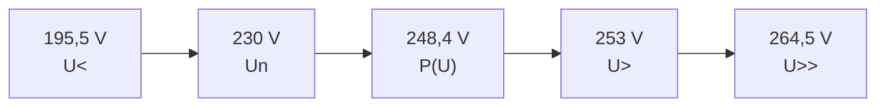

## Jak rozróżnić typ A i B

> [!abstract] Co zrozumiesz?
> Po przeczytaniu powinieneś umieć wyjaśnić temat własnymi słowami i powiązać go z pomiarami oraz realnym zachowaniem falownika. To **materiał dydaktyczny**, nie zatwierdzona konfiguracja urządzenia.

### Schemat: jak elementy są połączone

**Uwaga do grafiki:** schemat jest uproszczony. Nie pokazuje odległości w skali ani wszystkich warunków pomiarowych. Diagramy Mermaid są rysowane bezpośrednio przez Obsidiana, bez zewnętrznych plików graficznych.

## 1. Typ B a napięcie przyłączenia

### Co to znaczy po ludzku?
Dokument zawiera B dla sieci średniego i niskiego napięcia. Typ zależy od formalnej klasyfikacji modułu oraz wymagań, nie od pojedynczej etykiety poziomu napięcia.

### Przykład do prześledzenia
B/nn jest osobnym blokiem.

### Jak to rozpoznać w instalacji?
Wyobraź sobie, że stoisz przy rozdzielnicy i widzisz tylko wykres z analizatora oraz historię zdarzeń falownika. Zacznij od odczytu **jednostki i punktu pomiarowego**. Czy jest to napięcie fazowe, międzyfazowe, moc kW, moc kvar, czy częstotliwość Hz? Jeżeli widzisz wartość względną, zanotuj bazę. Potem porównaj sygnał **przed zdarzeniem**, **w trakcie** i **po zdarzeniu**. Przy parametrach typu »Typ B a napięcie przyłączenia« nie zaczynaj od szukania winnego elementu: najpierw ustal, czy jest to wymaganie regulatora, czy zabezpieczenia, i czy w ogóle warunek wystąpił.

Praktyczna sekwencja diagnostyczna dla automatyka: **pomiary → aktywna funkcja → próg i metoda obliczeń → oczekiwane działanie → faktyczny stan → wniosek**. Jeśli brakuje jednego ogniwa, wynik powinien brzmieć »nie potwierdzono«, a nie »falownik działa źle«. To szczególnie ważne przy krótkotrwałych zdarzeniach, bo SCADA aktualizowana co sekundę może ich nie zapisać.

### Ćwiczenie bez ryzyka
1. Zapisz własnymi słowami, dlaczego termin **Typ B a napięcie przyłączenia** jest istotny dla sieci. Nie przepisuj tabeli; opowiedz o fizycznym zjawisku.
2. Wypisz, które wielkości trzeba zmierzyć, aby stwierdzić, że zaszła opisana sytuacja.
3. Podaj, czego **nie da się** rozstrzygnąć z jednego odczytu lub zdjęcia ekranu.
4. Odpowiedz: jak odróżnisz zachowanie poprawne od awarii bez zmieniania żadnych nastaw?

> [!tip] Jedna rzecz do zapamiętania
> **Typ B a napięcie przyłączenia**: B/nn jest osobnym blokiem.

## 2. Podnapięcie B

### Co to znaczy po ludzku?
U< = 0,8 Un i 3 s. W porównaniu z A próg jest niższy, a zwłoka dłuższa. W typie B trzeba uwzględnić wymaganą pracę podczas zwarcia.

### Przykład do prześledzenia
Przy 230 V baza 0,8 Un wynosi 184 V.

### Jak to rozpoznać w instalacji?
Wyobraź sobie, że stoisz przy rozdzielnicy i widzisz tylko wykres z analizatora oraz historię zdarzeń falownika. Zacznij od odczytu **jednostki i punktu pomiarowego**. Czy jest to napięcie fazowe, międzyfazowe, moc kW, moc kvar, czy częstotliwość Hz? Jeżeli widzisz wartość względną, zanotuj bazę. Potem porównaj sygnał **przed zdarzeniem**, **w trakcie** i **po zdarzeniu**. Przy parametrach typu »Podnapięcie B« nie zaczynaj od szukania winnego elementu: najpierw ustal, czy jest to wymaganie regulatora, czy zabezpieczenia, i czy w ogóle warunek wystąpił.

Praktyczna sekwencja diagnostyczna dla automatyka: **pomiary → aktywna funkcja → próg i metoda obliczeń → oczekiwane działanie → faktyczny stan → wniosek**. Jeśli brakuje jednego ogniwa, wynik powinien brzmieć »nie potwierdzono«, a nie »falownik działa źle«. To szczególnie ważne przy krótkotrwałych zdarzeniach, bo SCADA aktualizowana co sekundę może ich nie zapisać.

### Ćwiczenie bez ryzyka
1. Zapisz własnymi słowami, dlaczego termin **Podnapięcie B** jest istotny dla sieci. Nie przepisuj tabeli; opowiedz o fizycznym zjawisku.
2. Wypisz, które wielkości trzeba zmierzyć, aby stwierdzić, że zaszła opisana sytuacja.
3. Podaj, czego **nie da się** rozstrzygnąć z jednego odczytu lub zdjęcia ekranu.
4. Odpowiedz: jak odróżnisz zachowanie poprawne od awarii bez zmieniania żadnych nastaw?

> [!tip] Jedna rzecz do zapamiętania
> **Podnapięcie B**: Przy 230 V baza 0,8 Un wynosi 184 V.

## 3. Nadnapięcie B

### Co to znaczy po ludzku?
U> = 1,1 Un z t=3 s. Tak jak w A uwzględnia się przypis dotyczący średniej 10-minutowej.

### Przykład do prześledzenia
253 V dla bazy fazowej 230 V.

### Jak to rozpoznać w instalacji?
Wyobraź sobie, że stoisz przy rozdzielnicy i widzisz tylko wykres z analizatora oraz historię zdarzeń falownika. Zacznij od odczytu **jednostki i punktu pomiarowego**. Czy jest to napięcie fazowe, międzyfazowe, moc kW, moc kvar, czy częstotliwość Hz? Jeżeli widzisz wartość względną, zanotuj bazę. Potem porównaj sygnał **przed zdarzeniem**, **w trakcie** i **po zdarzeniu**. Przy parametrach typu »Nadnapięcie B« nie zaczynaj od szukania winnego elementu: najpierw ustal, czy jest to wymaganie regulatora, czy zabezpieczenia, i czy w ogóle warunek wystąpił.

Praktyczna sekwencja diagnostyczna dla automatyka: **pomiary → aktywna funkcja → próg i metoda obliczeń → oczekiwane działanie → faktyczny stan → wniosek**. Jeśli brakuje jednego ogniwa, wynik powinien brzmieć »nie potwierdzono«, a nie »falownik działa źle«. To szczególnie ważne przy krótkotrwałych zdarzeniach, bo SCADA aktualizowana co sekundę może ich nie zapisać.

### Ćwiczenie bez ryzyka
1. Zapisz własnymi słowami, dlaczego termin **Nadnapięcie B** jest istotny dla sieci. Nie przepisuj tabeli; opowiedz o fizycznym zjawisku.
2. Wypisz, które wielkości trzeba zmierzyć, aby stwierdzić, że zaszła opisana sytuacja.
3. Podaj, czego **nie da się** rozstrzygnąć z jednego odczytu lub zdjęcia ekranu.
4. Odpowiedz: jak odróżnisz zachowanie poprawne od awarii bez zmieniania żadnych nastaw?

> [!tip] Jedna rzecz do zapamiętania
> **Nadnapięcie B**: 253 V dla bazy fazowej 230 V.

## 4. Nadnapięcie szybkie B

### Co to znaczy po ludzku?
U>> = 1,15 Un z t=0,1 s. To drugie, szybsze kryterium ochronne.

### Przykład do prześledzenia
264,5 V dla bazy fazowej 230 V.

### Jak to rozpoznać w instalacji?
Wyobraź sobie, że stoisz przy rozdzielnicy i widzisz tylko wykres z analizatora oraz historię zdarzeń falownika. Zacznij od odczytu **jednostki i punktu pomiarowego**. Czy jest to napięcie fazowe, międzyfazowe, moc kW, moc kvar, czy częstotliwość Hz? Jeżeli widzisz wartość względną, zanotuj bazę. Potem porównaj sygnał **przed zdarzeniem**, **w trakcie** i **po zdarzeniu**. Przy parametrach typu »Nadnapięcie szybkie B« nie zaczynaj od szukania winnego elementu: najpierw ustal, czy jest to wymaganie regulatora, czy zabezpieczenia, i czy w ogóle warunek wystąpił.

Praktyczna sekwencja diagnostyczna dla automatyka: **pomiary → aktywna funkcja → próg i metoda obliczeń → oczekiwane działanie → faktyczny stan → wniosek**. Jeśli brakuje jednego ogniwa, wynik powinien brzmieć »nie potwierdzono«, a nie »falownik działa źle«. To szczególnie ważne przy krótkotrwałych zdarzeniach, bo SCADA aktualizowana co sekundę może ich nie zapisać.

### Ćwiczenie bez ryzyka
1. Zapisz własnymi słowami, dlaczego termin **Nadnapięcie szybkie B** jest istotny dla sieci. Nie przepisuj tabeli; opowiedz o fizycznym zjawisku.
2. Wypisz, które wielkości trzeba zmierzyć, aby stwierdzić, że zaszła opisana sytuacja.
3. Podaj, czego **nie da się** rozstrzygnąć z jednego odczytu lub zdjęcia ekranu.
4. Odpowiedz: jak odróżnisz zachowanie poprawne od awarii bez zmieniania żadnych nastaw?

> [!tip] Jedna rzecz do zapamiętania
> **Nadnapięcie szybkie B**: 264,5 V dla bazy fazowej 230 V.

## 5. Częstotliwości B

### Co to znaczy po ludzku?
f< 47,5 Hz/1 s i f> 51,5 Hz/0,3 s. Te progi pozostają odrębne od regulatorów mocy.

### Przykład do prześledzenia
50,3 Hz nie przekracza progu f>.

### Jak to rozpoznać w instalacji?
Wyobraź sobie, że stoisz przy rozdzielnicy i widzisz tylko wykres z analizatora oraz historię zdarzeń falownika. Zacznij od odczytu **jednostki i punktu pomiarowego**. Czy jest to napięcie fazowe, międzyfazowe, moc kW, moc kvar, czy częstotliwość Hz? Jeżeli widzisz wartość względną, zanotuj bazę. Potem porównaj sygnał **przed zdarzeniem**, **w trakcie** i **po zdarzeniu**. Przy parametrach typu »Częstotliwości B« nie zaczynaj od szukania winnego elementu: najpierw ustal, czy jest to wymaganie regulatora, czy zabezpieczenia, i czy w ogóle warunek wystąpił.

Praktyczna sekwencja diagnostyczna dla automatyka: **pomiary → aktywna funkcja → próg i metoda obliczeń → oczekiwane działanie → faktyczny stan → wniosek**. Jeśli brakuje jednego ogniwa, wynik powinien brzmieć »nie potwierdzono«, a nie »falownik działa źle«. To szczególnie ważne przy krótkotrwałych zdarzeniach, bo SCADA aktualizowana co sekundę może ich nie zapisać.

### Ćwiczenie bez ryzyka
1. Zapisz własnymi słowami, dlaczego termin **Częstotliwości B** jest istotny dla sieci. Nie przepisuj tabeli; opowiedz o fizycznym zjawisku.
2. Wypisz, które wielkości trzeba zmierzyć, aby stwierdzić, że zaszła opisana sytuacja.
3. Podaj, czego **nie da się** rozstrzygnąć z jednego odczytu lub zdjęcia ekranu.
4. Odpowiedz: jak odróżnisz zachowanie poprawne od awarii bez zmieniania żadnych nastaw?

> [!tip] Jedna rzecz do zapamiętania
> **Częstotliwości B**: 50,3 Hz nie przekracza progu f>.

## 6. RoCoF B

### Co to znaczy po ludzku?
B: 2 Hz/s, maksymalny czas działania 0,2 s. To inne wartości niż A: 2,5 Hz/s i 0,5 s.

### Przykład do prześledzenia
Przykładowe 2,2 Hz/s przekracza wartość progową B.

### Jak to rozpoznać w instalacji?
Wyobraź sobie, że stoisz przy rozdzielnicy i widzisz tylko wykres z analizatora oraz historię zdarzeń falownika. Zacznij od odczytu **jednostki i punktu pomiarowego**. Czy jest to napięcie fazowe, międzyfazowe, moc kW, moc kvar, czy częstotliwość Hz? Jeżeli widzisz wartość względną, zanotuj bazę. Potem porównaj sygnał **przed zdarzeniem**, **w trakcie** i **po zdarzeniu**. Przy parametrach typu »RoCoF B« nie zaczynaj od szukania winnego elementu: najpierw ustal, czy jest to wymaganie regulatora, czy zabezpieczenia, i czy w ogóle warunek wystąpił.

Praktyczna sekwencja diagnostyczna dla automatyka: **pomiary → aktywna funkcja → próg i metoda obliczeń → oczekiwane działanie → faktyczny stan → wniosek**. Jeśli brakuje jednego ogniwa, wynik powinien brzmieć »nie potwierdzono«, a nie »falownik działa źle«. To szczególnie ważne przy krótkotrwałych zdarzeniach, bo SCADA aktualizowana co sekundę może ich nie zapisać.

### Ćwiczenie bez ryzyka
1. Zapisz własnymi słowami, dlaczego termin **RoCoF B** jest istotny dla sieci. Nie przepisuj tabeli; opowiedz o fizycznym zjawisku.
2. Wypisz, które wielkości trzeba zmierzyć, aby stwierdzić, że zaszła opisana sytuacja.
3. Podaj, czego **nie da się** rozstrzygnąć z jednego odczytu lub zdjęcia ekranu.
4. Odpowiedz: jak odróżnisz zachowanie poprawne od awarii bez zmieniania żadnych nastaw?

> [!tip] Jedna rzecz do zapamiętania
> **RoCoF B**: Przykładowe 2,2 Hz/s przekracza wartość progową B.

## 7. FRT jako wyjątek od intuicji

### Co to znaczy po ludzku?
Typ B ma utrzymywać pracę w odpowiednim profilu spadku U. Nie oznacza to, że każde zwarcie trzeba przetrwać bez względu na przebieg.

### Przykład do prześledzenia
Nie wolno konfigurować U< bez sprawdzenia FRT.

### Jak to rozpoznać w instalacji?
Wyobraź sobie, że stoisz przy rozdzielnicy i widzisz tylko wykres z analizatora oraz historię zdarzeń falownika. Zacznij od odczytu **jednostki i punktu pomiarowego**. Czy jest to napięcie fazowe, międzyfazowe, moc kW, moc kvar, czy częstotliwość Hz? Jeżeli widzisz wartość względną, zanotuj bazę. Potem porównaj sygnał **przed zdarzeniem**, **w trakcie** i **po zdarzeniu**. Przy parametrach typu »FRT jako wyjątek od intuicji« nie zaczynaj od szukania winnego elementu: najpierw ustal, czy jest to wymaganie regulatora, czy zabezpieczenia, i czy w ogóle warunek wystąpił.

Praktyczna sekwencja diagnostyczna dla automatyka: **pomiary → aktywna funkcja → próg i metoda obliczeń → oczekiwane działanie → faktyczny stan → wniosek**. Jeśli brakuje jednego ogniwa, wynik powinien brzmieć »nie potwierdzono«, a nie »falownik działa źle«. To szczególnie ważne przy krótkotrwałych zdarzeniach, bo SCADA aktualizowana co sekundę może ich nie zapisać.

### Ćwiczenie bez ryzyka
1. Zapisz własnymi słowami, dlaczego termin **FRT jako wyjątek od intuicji** jest istotny dla sieci. Nie przepisuj tabeli; opowiedz o fizycznym zjawisku.
2. Wypisz, które wielkości trzeba zmierzyć, aby stwierdzić, że zaszła opisana sytuacja.
3. Podaj, czego **nie da się** rozstrzygnąć z jednego odczytu lub zdjęcia ekranu.
4. Odpowiedz: jak odróżnisz zachowanie poprawne od awarii bez zmieniania żadnych nastaw?

> [!tip] Jedna rzecz do zapamiętania
> **FRT jako wyjątek od intuicji**: Nie wolno konfigurować U< bez sprawdzenia FRT.

## 8. Prąd bierny podczas zwarcia

### Co to znaczy po ludzku?
B powinno zapewniać szybką odpowiedź prądu biernego przy odpowiednich zwarciach. Ważne są K1/K2, Utrig oraz ograniczenie Imax.

### Przykład do prześledzenia
Wymagania dynamiczne mierzone są w dziesiątkach milisekund.

### Jak to rozpoznać w instalacji?
Wyobraź sobie, że stoisz przy rozdzielnicy i widzisz tylko wykres z analizatora oraz historię zdarzeń falownika. Zacznij od odczytu **jednostki i punktu pomiarowego**. Czy jest to napięcie fazowe, międzyfazowe, moc kW, moc kvar, czy częstotliwość Hz? Jeżeli widzisz wartość względną, zanotuj bazę. Potem porównaj sygnał **przed zdarzeniem**, **w trakcie** i **po zdarzeniu**. Przy parametrach typu »Prąd bierny podczas zwarcia« nie zaczynaj od szukania winnego elementu: najpierw ustal, czy jest to wymaganie regulatora, czy zabezpieczenia, i czy w ogóle warunek wystąpił.

Praktyczna sekwencja diagnostyczna dla automatyka: **pomiary → aktywna funkcja → próg i metoda obliczeń → oczekiwane działanie → faktyczny stan → wniosek**. Jeśli brakuje jednego ogniwa, wynik powinien brzmieć »nie potwierdzono«, a nie »falownik działa źle«. To szczególnie ważne przy krótkotrwałych zdarzeniach, bo SCADA aktualizowana co sekundę może ich nie zapisać.

### Ćwiczenie bez ryzyka
1. Zapisz własnymi słowami, dlaczego termin **Prąd bierny podczas zwarcia** jest istotny dla sieci. Nie przepisuj tabeli; opowiedz o fizycznym zjawisku.
2. Wypisz, które wielkości trzeba zmierzyć, aby stwierdzić, że zaszła opisana sytuacja.
3. Podaj, czego **nie da się** rozstrzygnąć z jednego odczytu lub zdjęcia ekranu.
4. Odpowiedz: jak odróżnisz zachowanie poprawne od awarii bez zmieniania żadnych nastaw?

> [!tip] Jedna rzecz do zapamiętania
> **Prąd bierny podczas zwarcia**: Wymagania dynamiczne mierzone są w dziesiątkach milisekund.

## 9. Punkt pomiarowy

### Co to znaczy po ludzku?
Przed wdrożeniem ustal, gdzie wyznaczane są U i Q oraz jak się to ma do PCC. Nie utożsamiaj rejestrów falownika z warunkami w punkcie przyłączenia.

### Przykład do prześledzenia
Transformator może zmieniać widoczny poziom Q.

### Jak to rozpoznać w instalacji?
Wyobraź sobie, że stoisz przy rozdzielnicy i widzisz tylko wykres z analizatora oraz historię zdarzeń falownika. Zacznij od odczytu **jednostki i punktu pomiarowego**. Czy jest to napięcie fazowe, międzyfazowe, moc kW, moc kvar, czy częstotliwość Hz? Jeżeli widzisz wartość względną, zanotuj bazę. Potem porównaj sygnał **przed zdarzeniem**, **w trakcie** i **po zdarzeniu**. Przy parametrach typu »Punkt pomiarowy« nie zaczynaj od szukania winnego elementu: najpierw ustal, czy jest to wymaganie regulatora, czy zabezpieczenia, i czy w ogóle warunek wystąpił.

Praktyczna sekwencja diagnostyczna dla automatyka: **pomiary → aktywna funkcja → próg i metoda obliczeń → oczekiwane działanie → faktyczny stan → wniosek**. Jeśli brakuje jednego ogniwa, wynik powinien brzmieć »nie potwierdzono«, a nie »falownik działa źle«. To szczególnie ważne przy krótkotrwałych zdarzeniach, bo SCADA aktualizowana co sekundę może ich nie zapisać.

### Ćwiczenie bez ryzyka
1. Zapisz własnymi słowami, dlaczego termin **Punkt pomiarowy** jest istotny dla sieci. Nie przepisuj tabeli; opowiedz o fizycznym zjawisku.
2. Wypisz, które wielkości trzeba zmierzyć, aby stwierdzić, że zaszła opisana sytuacja.
3. Podaj, czego **nie da się** rozstrzygnąć z jednego odczytu lub zdjęcia ekranu.
4. Odpowiedz: jak odróżnisz zachowanie poprawne od awarii bez zmieniania żadnych nastaw?

> [!tip] Jedna rzecz do zapamiętania
> **Punkt pomiarowy**: Transformator może zmieniać widoczny poziom Q.

## 10. Test zgodności

### Co to znaczy po ludzku?
Potrzebne są uzgodnienia i badania właściwe dla obiektu. Samo zgodne menu falownika nie potwierdza wszystkich wymagań farmy.

### Przykład do prześledzenia
Zapisz firmware, certyfikat, zestaw parametrów oraz zakres badań.

### Jak to rozpoznać w instalacji?
Wyobraź sobie, że stoisz przy rozdzielnicy i widzisz tylko wykres z analizatora oraz historię zdarzeń falownika. Zacznij od odczytu **jednostki i punktu pomiarowego**. Czy jest to napięcie fazowe, międzyfazowe, moc kW, moc kvar, czy częstotliwość Hz? Jeżeli widzisz wartość względną, zanotuj bazę. Potem porównaj sygnał **przed zdarzeniem**, **w trakcie** i **po zdarzeniu**. Przy parametrach typu »Test zgodności« nie zaczynaj od szukania winnego elementu: najpierw ustal, czy jest to wymaganie regulatora, czy zabezpieczenia, i czy w ogóle warunek wystąpił.

Praktyczna sekwencja diagnostyczna dla automatyka: **pomiary → aktywna funkcja → próg i metoda obliczeń → oczekiwane działanie → faktyczny stan → wniosek**. Jeśli brakuje jednego ogniwa, wynik powinien brzmieć »nie potwierdzono«, a nie »falownik działa źle«. To szczególnie ważne przy krótkotrwałych zdarzeniach, bo SCADA aktualizowana co sekundę może ich nie zapisać.

### Ćwiczenie bez ryzyka
1. Zapisz własnymi słowami, dlaczego termin **Test zgodności** jest istotny dla sieci. Nie przepisuj tabeli; opowiedz o fizycznym zjawisku.
2. Wypisz, które wielkości trzeba zmierzyć, aby stwierdzić, że zaszła opisana sytuacja.
3. Podaj, czego **nie da się** rozstrzygnąć z jednego odczytu lub zdjęcia ekranu.
4. Odpowiedz: jak odróżnisz zachowanie poprawne od awarii bez zmieniania żadnych nastaw?

> [!tip] Jedna rzecz do zapamiętania
> **Test zgodności**: Zapisz firmware, certyfikat, zestaw parametrów oraz zakres badań.

## Studium przypadków: od schematu do wniosku

### Scenariusz 1: Typ B a napięcie przyłączenia
Masz zadanie sprawdzić instalację, w której operator zgłosił nietypowe zachowanie związane z obszarem **Typ B a napięcie przyłączenia**. W pierwszym kroku nie zmieniasz konfiguracji. Przygotowujesz zestaw danych: topologię przyłączenia, wartości znamionowe i bazy, historię U/f/P/Q, znaczniki czasu, stany sterowania nadrzędnego i kody zdarzeń. **Hipoteza robocza:** Dokument zawiera B dla sieci średniego i niskiego napięcia. Typ zależy od formalnej klasyfikacji modułu oraz wymagań, nie od pojedynczej etykiety poziomu napięcia. Zestaw tę hipotezę z obserwacją: B/nn jest osobnym blokiem. Następnie odpowiedz, co potwierdza wymaganie dokumentu, a co jest tylko możliwym zachowaniem konkretnego urządzenia. Gdy pojawia się sprzeczność, sprawdź najpierw jednostki i kierunki przepływu, dopiero potem oceniaj oprogramowanie. Zakończ tabelą: obserwacja, oczekiwane zachowanie, źródło wymagania, dane brakujące, werdykt. Nie wykonuj prób zwarciowych ani zmiany zabezpieczeń w czynnej instalacji.

### Scenariusz 2: Podnapięcie B
Masz zadanie sprawdzić instalację, w której operator zgłosił nietypowe zachowanie związane z obszarem **Podnapięcie B**. W pierwszym kroku nie zmieniasz konfiguracji. Przygotowujesz zestaw danych: topologię przyłączenia, wartości znamionowe i bazy, historię U/f/P/Q, znaczniki czasu, stany sterowania nadrzędnego i kody zdarzeń. **Hipoteza robocza:** U< = 0,8 Un i 3 s. W porównaniu z A próg jest niższy, a zwłoka dłuższa. W typie B trzeba uwzględnić wymaganą pracę podczas zwarcia. Zestaw tę hipotezę z obserwacją: Przy 230 V baza 0,8 Un wynosi 184 V. Następnie odpowiedz, co potwierdza wymaganie dokumentu, a co jest tylko możliwym zachowaniem konkretnego urządzenia. Gdy pojawia się sprzeczność, sprawdź najpierw jednostki i kierunki przepływu, dopiero potem oceniaj oprogramowanie. Zakończ tabelą: obserwacja, oczekiwane zachowanie, źródło wymagania, dane brakujące, werdykt. Nie wykonuj prób zwarciowych ani zmiany zabezpieczeń w czynnej instalacji.

### Scenariusz 3: Nadnapięcie B
Masz zadanie sprawdzić instalację, w której operator zgłosił nietypowe zachowanie związane z obszarem **Nadnapięcie B**. W pierwszym kroku nie zmieniasz konfiguracji. Przygotowujesz zestaw danych: topologię przyłączenia, wartości znamionowe i bazy, historię U/f/P/Q, znaczniki czasu, stany sterowania nadrzędnego i kody zdarzeń. **Hipoteza robocza:** U> = 1,1 Un z t=3 s. Tak jak w A uwzględnia się przypis dotyczący średniej 10-minutowej. Zestaw tę hipotezę z obserwacją: 253 V dla bazy fazowej 230 V. Następnie odpowiedz, co potwierdza wymaganie dokumentu, a co jest tylko możliwym zachowaniem konkretnego urządzenia. Gdy pojawia się sprzeczność, sprawdź najpierw jednostki i kierunki przepływu, dopiero potem oceniaj oprogramowanie. Zakończ tabelą: obserwacja, oczekiwane zachowanie, źródło wymagania, dane brakujące, werdykt. Nie wykonuj prób zwarciowych ani zmiany zabezpieczeń w czynnej instalacji.

### Scenariusz 4: Nadnapięcie szybkie B
Masz zadanie sprawdzić instalację, w której operator zgłosił nietypowe zachowanie związane z obszarem **Nadnapięcie szybkie B**. W pierwszym kroku nie zmieniasz konfiguracji. Przygotowujesz zestaw danych: topologię przyłączenia, wartości znamionowe i bazy, historię U/f/P/Q, znaczniki czasu, stany sterowania nadrzędnego i kody zdarzeń. **Hipoteza robocza:** U>> = 1,15 Un z t=0,1 s. To drugie, szybsze kryterium ochronne. Zestaw tę hipotezę z obserwacją: 264,5 V dla bazy fazowej 230 V. Następnie odpowiedz, co potwierdza wymaganie dokumentu, a co jest tylko możliwym zachowaniem konkretnego urządzenia. Gdy pojawia się sprzeczność, sprawdź najpierw jednostki i kierunki przepływu, dopiero potem oceniaj oprogramowanie. Zakończ tabelą: obserwacja, oczekiwane zachowanie, źródło wymagania, dane brakujące, werdykt. Nie wykonuj prób zwarciowych ani zmiany zabezpieczeń w czynnej instalacji.

### Scenariusz 5: Częstotliwości B
Masz zadanie sprawdzić instalację, w której operator zgłosił nietypowe zachowanie związane z obszarem **Częstotliwości B**. W pierwszym kroku nie zmieniasz konfiguracji. Przygotowujesz zestaw danych: topologię przyłączenia, wartości znamionowe i bazy, historię U/f/P/Q, znaczniki czasu, stany sterowania nadrzędnego i kody zdarzeń. **Hipoteza robocza:** f< 47,5 Hz/1 s i f> 51,5 Hz/0,3 s. Te progi pozostają odrębne od regulatorów mocy. Zestaw tę hipotezę z obserwacją: 50,3 Hz nie przekracza progu f>. Następnie odpowiedz, co potwierdza wymaganie dokumentu, a co jest tylko możliwym zachowaniem konkretnego urządzenia. Gdy pojawia się sprzeczność, sprawdź najpierw jednostki i kierunki przepływu, dopiero potem oceniaj oprogramowanie. Zakończ tabelą: obserwacja, oczekiwane zachowanie, źródło wymagania, dane brakujące, werdykt. Nie wykonuj prób zwarciowych ani zmiany zabezpieczeń w czynnej instalacji.

### Scenariusz 6: RoCoF B
Masz zadanie sprawdzić instalację, w której operator zgłosił nietypowe zachowanie związane z obszarem **RoCoF B**. W pierwszym kroku nie zmieniasz konfiguracji. Przygotowujesz zestaw danych: topologię przyłączenia, wartości znamionowe i bazy, historię U/f/P/Q, znaczniki czasu, stany sterowania nadrzędnego i kody zdarzeń. **Hipoteza robocza:** B: 2 Hz/s, maksymalny czas działania 0,2 s. To inne wartości niż A: 2,5 Hz/s i 0,5 s. Zestaw tę hipotezę z obserwacją: Przykładowe 2,2 Hz/s przekracza wartość progową B. Następnie odpowiedz, co potwierdza wymaganie dokumentu, a co jest tylko możliwym zachowaniem konkretnego urządzenia. Gdy pojawia się sprzeczność, sprawdź najpierw jednostki i kierunki przepływu, dopiero potem oceniaj oprogramowanie. Zakończ tabelą: obserwacja, oczekiwane zachowanie, źródło wymagania, dane brakujące, werdykt. Nie wykonuj prób zwarciowych ani zmiany zabezpieczeń w czynnej instalacji.

### Scenariusz 7: FRT jako wyjątek od intuicji
Masz zadanie sprawdzić instalację, w której operator zgłosił nietypowe zachowanie związane z obszarem **FRT jako wyjątek od intuicji**. W pierwszym kroku nie zmieniasz konfiguracji. Przygotowujesz zestaw danych: topologię przyłączenia, wartości znamionowe i bazy, historię U/f/P/Q, znaczniki czasu, stany sterowania nadrzędnego i kody zdarzeń. **Hipoteza robocza:** Typ B ma utrzymywać pracę w odpowiednim profilu spadku U. Nie oznacza to, że każde zwarcie trzeba przetrwać bez względu na przebieg. Zestaw tę hipotezę z obserwacją: Nie wolno konfigurować U< bez sprawdzenia FRT. Następnie odpowiedz, co potwierdza wymaganie dokumentu, a co jest tylko możliwym zachowaniem konkretnego urządzenia. Gdy pojawia się sprzeczność, sprawdź najpierw jednostki i kierunki przepływu, dopiero potem oceniaj oprogramowanie. Zakończ tabelą: obserwacja, oczekiwane zachowanie, źródło wymagania, dane brakujące, werdykt. Nie wykonuj prób zwarciowych ani zmiany zabezpieczeń w czynnej instalacji.

### Scenariusz 8: Prąd bierny podczas zwarcia
Masz zadanie sprawdzić instalację, w której operator zgłosił nietypowe zachowanie związane z obszarem **Prąd bierny podczas zwarcia**. W pierwszym kroku nie zmieniasz konfiguracji. Przygotowujesz zestaw danych: topologię przyłączenia, wartości znamionowe i bazy, historię U/f/P/Q, znaczniki czasu, stany sterowania nadrzędnego i kody zdarzeń. **Hipoteza robocza:** B powinno zapewniać szybką odpowiedź prądu biernego przy odpowiednich zwarciach. Ważne są K1/K2, Utrig oraz ograniczenie Imax. Zestaw tę hipotezę z obserwacją: Wymagania dynamiczne mierzone są w dziesiątkach milisekund. Następnie odpowiedz, co potwierdza wymaganie dokumentu, a co jest tylko możliwym zachowaniem konkretnego urządzenia. Gdy pojawia się sprzeczność, sprawdź najpierw jednostki i kierunki przepływu, dopiero potem oceniaj oprogramowanie. Zakończ tabelą: obserwacja, oczekiwane zachowanie, źródło wymagania, dane brakujące, werdykt. Nie wykonuj prób zwarciowych ani zmiany zabezpieczeń w czynnej instalacji.

## Koniec rozdziału — pięć pytań
1. Jakie fizyczne zjawisko omawia ten rozdział?
2. Kiedy urządzenie powinno **regulować moc**, a kiedy działać ochronnie?
3. Który sygnał trzeba sprawdzić w PLC/SCADA i z jaką rozdzielczością czasową?
4. Jakie dane o urządzeniu i sieci trzeba ustalić przed oceną zdarzenia?
5. Co stanowi wymaganie literalne PTPiREE, a co jest jedynie objaśnieniem dydaktycznym?

Źródło: [PTPiREE – Bank Nastaw dla Polski, wersja 1.1, 01.10.2024](https://ptpiree.pl/wp-content/uploads/2024/12/bn_2024_10_01-1.pdf). Szczegółowe wykresy i przypisy sprawdź w źródłowym PDF.
